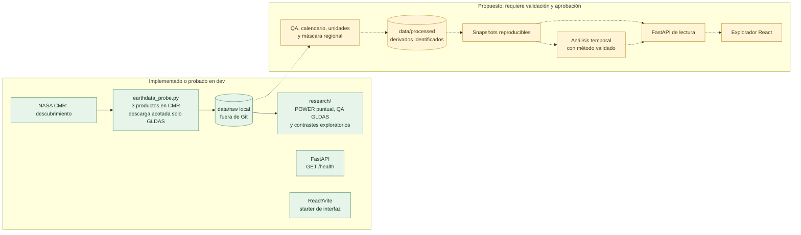

# Arquitectura de Anomaly Zero — estado actual y propuesta FUL-99

**Base auditada:** `dev` en `eacd9e45915dd01b2298b948234e784d8be23192` (14 de noviembre de 2026).

**Estado de este documento:** arquitectura descriptiva y propuesta para revisión; no constituye aprobación científica o de equipo.

## Propósito y alcance

Anomaly Zero investiga temperatura del aire, precipitación y humedad del suelo en la región candidata Murray–Darling durante una ventana objetivo 2005–2024. El inventario CMR, un archivo descargado, la cobertura de píxeles, un agregado regional y una tendencia son niveles de evidencia distintos. El catálogo y sus límites están en [datasets.md](datasets.md) y [catalog_mvp.json](catalog_mvp.json).

La arquitectura distingue los hechos implementados, los resultados experimentales y el flujo futuro. No propone microservicios, colas, base de datos, hosting ni descargas NASA durante peticiones HTTP.

## Componentes existentes en `dev`

| Componente | Implementación observada | Qué demuestra | Qué no demuestra |
| --- | --- | --- | --- |
| Fuentes y catálogo | Fichas de MERRA-2, IMERG Final y GLDAS Noah en `docs/catalog_mvp.json`; documentación de fuentes y región | Identidad/versiones candidatas, evidencias y pendientes registrados | Aprobación del MVP, cobertura válida o interoperabilidad científica |
| Adquisición | `backend/app/data_sources/earthdata_probe.py`: consulta CMR para los tres productos; comando de descarga acotada solo para un granulo GLDAS mensual; inspección NetCDF4, hash y manifiesto | Descubrimiento público y flujo técnico de una descarga autenticada GLDAS, probado offline/con evidencia local | Descargas de MERRA-2 o IMERG, lotes históricos, máscaras o QA científica |
| Datos originales | `data/raw/`, ignorado por Git; el repositorio no contiene la muestra GLDAS ni las cachés originales | Ubicación local prevista para datos y manifiestos | Almacenamiento compartido o snapshots reproducibles publicados |
| Investigación y QA | `research/power_data.py`, `series_quality.py`, notebooks FUL-101; `research/gldas_qa.py` y notebook FUL-105; scripts de contraste FUL-102 | Piloto POWER en punto; QA/EDA de un mes GLDAS sobre rectángulo; contrastes exploratorios IMERG y copias NCAR | Procesador científico productivo, serie de cuenca o motor de tendencias |
| Procesamiento productivo | `backend/app/analysis/` solo contiene `.gitkeep` | La ruta está reservada | Funciones de agregación, snapshots o tendencias implementadas |
| API | `backend/app/main.py` expone `GET /health` | La API responde salud del proceso | Endpoints de catálogo, datos, series, mapas o estadísticas |
| Frontend | React/TypeScript/Vite está instalado; `frontend/src/App.tsx` mantiene la pantalla de inicio del starter Vite | La aplicación frontend compila como base del proyecto | Explorador NASA, selector regional, series o mapas del producto |
| Servicios y esquemas | `backend/app/services/` y `schemas/` solo contienen `.gitkeep` | No hay servicios/schemas de datos publicados | Contrato API científico; FUL-108 sigue pendiente |

FUL-101, FUL-102, FUL-103 y el avance GLDAS de FUL-105 están integrados en `dev`. Véanse [sondeo Earthdata](earthdata-probe.md), [EDA GLDAS](eda-gldas-preliminar.md) y [contraste de fuentes](contraste_fuentes.md). La PR #7 de FUL-105 no significa que la tarjeta científica completa o la cuenca estén validadas.

## Diagrama: implementación y propuesta

Las flechas sólidas describen conexiones disponibles en esta versión; las punteadas son un flujo de trabajo propuesto, no código integrado. La consulta CMR con bounding box selecciona granulos candidatos: no recorta píxeles ni genera una máscara de cuenca.

## Separación de módulos propuesta

El flujo objetivo, sujeto a aprobación en FUL-99/107/108, es **fuente y catálogo → adquisición controlada → originales y manifiestos → QA/procesamiento reproducible → snapshots → API de lectura → interfaz**. La descarga debe ocurrir fuera de peticiones del frontend.

- **Fuentes NASA y catálogo (Lucas):** mantener los tres candidatos, versiones, variables, unidades, documentación, cobertura, calidad y restricciones de uso; enlazar a la evidencia existente en vez de duplicarla.
- **Adquisición (Alaín):** mantener CMR/Earthdata, autenticación local, límites, procedencia, inspección y hashes. En la revisión, la rama remota `feature/ful-106-be-02-three-product-samples` está en `78f8a19`, cinco commits detrás de `dev`, sin commits propios respecto a `dev` ni PR abierta. Esto no determina el estado de trabajo externo a GitHub; FUL-106 debe publicar el estado real de extracción de cada fuente antes de describirlo aquí como implementado.
- **Originales (Alaín + equipo):** conservar cada archivo fuente y manifiesto fuera de Git. Manifiestos actuales no equivalen a un sistema de snapshots compartido.
- **Investigación/QA/estadística (César, validación científica con Lucas):** explorar en `research/`; migrar a `backend/app/analysis/` solo funciones estables, revisadas y probadas. Mantener separados los valores originales, transformaciones, faltantes y resultados estadísticos.
- **API (Alaín + equipo):** hoy solo salud. Un futuro servicio podría leer snapshots verificados, no iniciar descargas de NASA en cada request. Los contratos quedan sujetos a FUL-108.
- **Interfaz (Alejandra):** frontend actual basado en Vite. Un futuro explorador necesita contrato, procedencia, cobertura, estados vacíos y advertencias científicas antes de dibujar una serie o mapa.

## Datos, procedencia y límites científicos

Los tres productos continúan en el alcance de investigación:

- **MERRA-2 `M2TMNXSLV` 5.12.4 / `T2M`:** la copia NCAR reorganizada contiene 12 meses de 2005 y unidad K; el gránulo NASA original no se abrió y su acceso anónimo devolvió 401.
- **IMERG Final `GPM_3IMERGM` 07 / `precipitation`:** hay muestras y QA básica, incluida exploración de campos de calidad; quedan filtro QA, máscara de cuenca y validación independiente.
- **GLDAS Noah `GLDAS_NOAH025_M` 2.1 / `SoilMoi0_10cm_inst`:** hay una descarga autenticada real de enero de 2005 y EDA de 3.360 celdas del rectángulo (3.045 válidas, 315 faltantes). La media 16,0753 kg/m² es sin ponderación; no es una estimación de la cuenca. El linaje respecto del posprocesamiento de aguas continentales sigue pendiente.

Los 240 meses CMR de 2005–2024 por colección son registros de catálogo, no una serie de 240 valores regionales. El límite MDBA y los ensayos exploratorios con IMERG se describen en [region_murray_darling.md](region_murray_darling.md): el GeoJSON versionado es solo un segmento `LineString`, no el polígono completo. La geometría, CRS, celdas de borde, áreas, faltantes y ponderación siguen sujetos a FUL-104. No afirmar agregación de cuenca, tendencia o significancia hasta que los datos y métodos correspondientes estén validados.

Un snapshot futuro debería poder identificar fuente/versión, variable, periodo/calendario, unidad original y conversiones, geometría/CRS y método espacial, cobertura y calidad, transformaciones, incertidumbre/estado, hashes de origen/derivado y versión del proceso. Los resultados no disponibles deben representarse como estado explícito o `null`, nunca como cero ficticio.

## Responsabilidades y coordinación

El README asigna Data Science/estadística a César, datos y productos NASA a Lucas, backend/extracción a Alaín y frontend a Alejandra. FUL-99 identifica a Lucas como responsable de tarjeta y a César/Alaín como colaboradores; no se encontró una revisión técnica de la antigua PR #2 que ratifique el diseño. No se infieren conformidades de estas personas por el merge de otras tarjetas.

- **FUL-104 / Lucas:** confirmar geometría oficial completa, CRS, bordes, ponderación, QA/unidades y linaje GLDAS.
- **FUL-105 / César:** completar EDA de los tres productos, temporalidad y plan analítico; enero 2005 de GLDAS es un avance parcial.
- **FUL-106 / Alaín:** registrar archivos/muestras, versiones, hashes, variables, atributos, problemas de acceso y comandos reproducibles.
- **FUL-107 / equipo:** elegir el primer caso científico implementable con evidencia; [borrador de alcance](alcance-cientifico-provisional.md).
- **FUL-108 / Alaín + equipo:** definir contratos solo después de acordar producto, región, calidad y salida científica.

## Riesgo de validación automática

`.github/workflows/checks.yml` todavía limita `pull_request` a `develop` y `push` a la antigua rama FUL-103. Además, `pyproject.toml` dirige el descubrimiento predeterminado de pytest a `backend/tests`, dejando fuera `research/tests`. Una corrección pequeña de CI para `dev` y las pruebas de investigación se recomienda por separado; esta PR documental no modifica ese workflow.

## Historial de la propuesta anterior

La PR #2 (`docs/ful-99-arquitectura-propuesta`) se cerró sin merge cuando GitHub registró el evento `base_ref_deleted`; su descripción pedía revisión, pero no hay reviews y el evento no registra un desacuerdo técnico. La rama conserva un borrador extenso que no coincide con la arquitectura mínima hoy implementada. Se reutiliza solo la separación entre adquisición, raw/procedencia, proceso, snapshots y API de lectura, marcada aquí como propuesta. La rama antigua no se fusionó.
