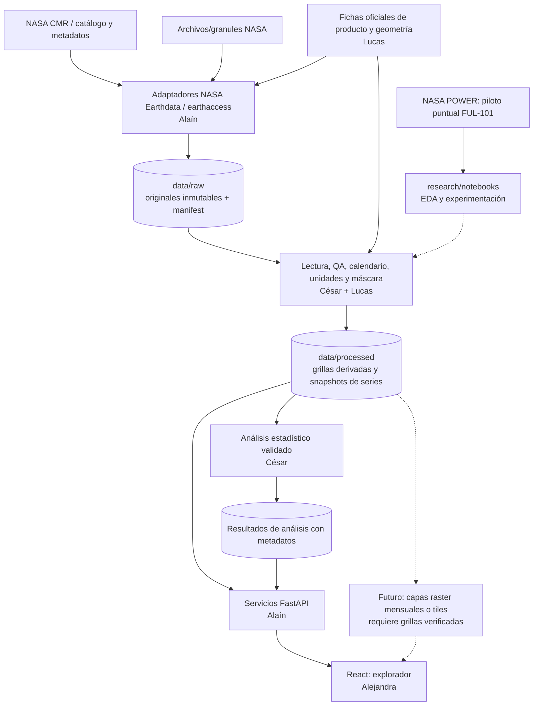

# Arquitectura de Anomaly Zero — FUL-99

> **Estado: PROPUESTA PARA REVISIÓN** · 14 de noviembre de 2026.  
> **Responsable de FUL-99:** Lucas Moncada. **Proponente de este borrador:** César Rojas. **Revisión requerida:** Lucas (fuentes, geografía y calidad), Alaín/Jod (obtención de datos y servicios); Alejandra (viabilidad de UX cuando corresponda).  
> **Rama de propuesta:** `docs/ful-99-arquitectura-propuesta`. **Destino previsto:** `dev`. **No constituye aprobación científica ni técnica definitiva.**

## 1. Propósito, decisiones de alcance y límites

Anomaly Zero busca explorar tendencias ambientales con datos de NASA, mostrando una serie temporal y la evidencia científica que sustenta su interpretación. La arquitectura debe permitir pasar de una **variable con datos reales** a tres variables sin reconstruir sus módulos, y preparar un futuro mapa temporal sin condicionarlo como requisito de la primera entrega.

**Tres decisiones propuestas por César para validar con el equipo:**

1. **Primera experiencia:** serie mensual representativa de la región y estadísticas descriptivas; tendencias e incertidumbre solo cuando una metodología validada lo permita. Un mapa espacial queda preparado a nivel de modelo y dependencias, no implementado en FUL-99.
2. **Alcance:** primero una variable científicamente viable; la misma arquitectura debe aceptar temperatura del aire, precipitación y humedad del suelo mediante identificadores/metadatos, no `if/else` dispersos ni tres aplicaciones paralelas.
3. **Datos:** ingesta y procesamiento por lotes fuera del ciclo HTTP; FastAPI **lee snapshots** procesados y ofrece respuestas livianas. No descarga un histórico NASA en cada consulta React.

La selección de la primera variable, la geometría final de la cuenca, el rango temporal efectivamente validado y el método inferencial pertenecen a **FUL-104/106/105/107**, no se consideran confirmados aquí.

### Estado tecnológico confirmado en `dev`

- Monorepositorio privado: `frontend/` (React/TypeScript/Vite), `backend/app/` (FastAPI), `research/notebooks/`, `data/{raw,processed,cache}/` y `docs/`.
- Python 3.12, un único `pyproject.toml` y `uv.lock` para API y notebooks; grupos `research` y `dev`.
- FastAPI tiene `GET /health` y `/docs`; **no hay todavía servicios científicos productivos**.
- FUL-101 fue fusionada a `dev`: NASA POWER `T2M` mensual para un **punto** de Wagga Wagga, con notebook, utilidades de calidad y caché validado. **No es un promedio de Murray–Darling** y no certifica los productos de producción.
- MERRA-2 `M2TMNXSLV/T2M`, GPM IMERG Final V07 `GPM_3IMERGM/precipitation` y GLDAS Noah V2.1 `GLDAS_NOAH025_M/SoilMoi0_10cm_inst` siguen siendo **candidatos**, aún sin QA de archivos reales. Enero 2005–diciembre 2024 es una **ventana objetivo**, no una serie científicamente validada.

## 2. Diagrama de componentes y flujos



**Nota:** las flechas de la propuesta representan responsabilidades previstas, no pipelines ya implementados. El catálogo/CMR identifica archivos; una búsqueda con bounding box **no recorta píxeles**, no construye una máscara y no prueba valores válidos en la región.

## 3. Fronteras de responsabilidad y ubicación del código

| Módulo/ruta | Entrada | Salida | Responsable | Estado |
| --- | --- | --- | --- | --- |
| `docs/datasets.md` y posible catálogo estructurado | Metadatos oficiales, URLs y DOI | Productos/variables/QA esperado | Lucas | FUL-102/104; pendiente |
| `backend/app/data_sources/` | CMR, Earthdata, parámetros de descarga | Archivos NASA originales + manifest | Alaín | FUL-103/106; pendiente |
| `data/raw/` | Granules originales y sidecar | Evidencia original inalterada | Alaín | Carpeta existente |
| `backend/app/analysis/` (destino de código validado) | Datos originales/derivados + metadatos + geometría | QA, agregados y resultados estadísticos | César, validación Lucas | Propuesto; implementación posterior |
| `research/notebooks/` y `research/*.py` | Muestras reales o fixtures explícitos | EDA, hipótesis, utilidades exploratorias | César | Piloto FUL-101 integrado |
| `data/processed/` | Grillas y series validadas | Snapshots reproducibles, manifiestos | César + Alaín | Especificación propuesta |
| `backend/app/services/` | Snapshots, catálogos y resultados | Operaciones de lectura para API | Alaín | Pendiente |
| `backend/app/schemas/` | Contratos versionados | Validación de peticiones/respuestas | Alaín + equipo | FUL-108, no congelado |
| `frontend/src/` | Respuestas ligeras de FastAPI | Gráficos, controles, origen/advertencias | Alejandra | FE-01/FE-02 |

**Regla de módulos:** el notebook permite explorar; las funciones científicas **estables y probadas** podrán migrarse o compartirse desde `backend/app/analysis/`, una vez acordada su interfaz. No copiar algoritmos definitivos por separado al notebook, al servicio y al frontend. La lógica Python se importa, no se replica en TypeScript.

### Organización física mínima (sin crear nuevas plataformas)

```text
frontend/                   React (landing y explorador futuro)
backend/app/
  data_sources/             Metadatos, autenticación y descargas
  analysis/                 Transformaciones y estadísticas validadas
  services/                 Lectura/orquestación de snapshots
  schemas/                  Pydantic, cuando exista contrato FUL-108
  main.py                   FastAPI; GET /health ya existente
research/
  notebooks/                EDA y comprobaciones científicas
  power_data.py             Piloto POWER de FUL-101
  series_quality.py         Utilidades exploratorias de FUL-101
data/
  raw/                      Originales + sidecars locales, fuera de Git
  processed/                Grillas/series derivadas, fuera de Git
  cache/                    Copias recuperables, fuera de Git
docs/
  architecture.md           Este borrador
  decisions.md              Registro de decisiones y asuntos abiertos
  datasets.md               Productos candidatos y sus fuentes
```

## 4. Ciclo de vida de datos y snapshots

1. **Descubrir:** Lucas mantiene fichas verificables de producto, versiones, variables, resoluciones, cobertura, DOI, acceso, licencia y documentación oficial. Alaín consulta CMR para obtener IDs y granules concretos.
2. **Obtener:** Alaín realiza una descarga pequeña y autenticada desde NASA Earthdata; conserva el archivo bruto y un manifest (fecha, fuente, versión, SHA-256, ruta relativa). Nunca guarda contraseñas, tokens ni URL sensible firmada.
3. **Inspeccionar y validar:** comprobar formato (NetCDF/HDF), nombres de variables, dimensiones/coords, unidades, valores `_FillValue`, máscaras de calidad, tiempo y extensión geográfica. Un archivo legible **no garantiza** cobertura válida dentro de Murray–Darling.
4. **Transformar:** seleccionar una geometría oficial; recortar/enmascarar adecuadamente las celdas, justificar ponderaciones por área y conversiones físicas (si se aprueban) y producir grillas/series derivadas. No convertir faltantes a cero. No mezclar tasas, acumulados ni profundidades de suelo.
5. **Publicar snapshot:** generar de forma controlada una versión de datos **identificable e inmutable** (dataset, versión, región, período, método, fecha, hash del insumo y del derivado). La publicación lógica debe ser atómica: no exponer resultados incompletos como «últimos válidos».
6. **Servir:** FastAPI consulta el último snapshot validado y sus metadatos; devuelve una serie ligera o un estado de datos no disponibles. Nunca inicia descarga masiva de Earthdata como efecto de una consulta del frontend.
7. **Analizar:** el motor estadístico (por definir en FUL-105 y trabajo posterior) usa series válidas y registra método, parámetros, período, diagnóstico, pendiente/intervalo y advertencias. Cuando no exista inferencia, devolver estado pendiente y campos nulos, **no** valores ficticios.
8. **Mostrar:** React presenta serie, fuente, unidad, cobertura y fecha del snapshot; distingue «dato», «anomalía», «tendencia» y «significancia», y estados sin datos/error/desactualizado.

**Actualización y fallos:** primera versión con snapshots generados manualmente o mediante comandos explícitos, sin scheduler obligatorio. Si NASA falla, no sustituir el snapshot validado por un archivo parcial; mostrar fecha y estado de los datos disponibles. `/health` no depende de conexión a NASA. La frecuencia de actualización se definirá cuando se conozcan latencia y volumen reales.

## 5. Formatos internos provisionales (NO contrato HTTP)

### 5.1 Serie mensual de trabajo: tabla larga

Cada fila representa **un período mensual y un soporte espacial explícito**. Usar pandas y CSV para prueba inicial; considerar formatos columnar/grilla solo si tamaño y rendimiento lo justifican.

| Campo | Tipo conceptual | Obligación | Regla |
| --- | --- | --- | --- |
| `period` | `YYYY-MM` | Sí | Mes calendario, no timestamp de ejecución; zona/calendario fuente se documentan |
| `variable_id` | string | Sí | Identificador científico validado (ej. `T2M`) |
| `value` | float o null | Sí | `null` significa ausente, nunca cero por defecto |
| `unit` | string | Sí | Unidad que corresponde al valor **después** de transformaciones documentadas |
| `product_id` y `product_version` | string | Sí | Identifican el producto de origen, no solo la plataforma de distribución |
| `region_id` | string | Sí | Punto o polígono identificable; no implica por sí mismo agregación |
| `spatial_support` | enum provisional | Sí | `point`, `grid_cell` o `polygon_aggregate` |
| `quality_status` | enum provisional | Sí | `valid`, `partial`, `missing`, `rejected` |
| `coverage_fraction` | float o null | Condicional | Fracción espacial válida si hubo agregación; 0–1 |
| `snapshot_id` | string | Sí en derivados | Vincula con manifest, área, transformaciones y fuente |
| `quality_flags` | lista/string o null | Opcional | Mantener definición del proveedor en metadatos |

No reducir una grilla temporal completa a esta tabla si se necesitarán mapas; conservar los rasters derivados independientemente. La serie agregada y la grilla no son objetos equivalentes.

**Ejemplo ESTRUCTURAL, NO DATO REAL:**

```json
{
  "period": "2005-01",
  "variable_id": "T2M",
  "value": null,
  "unit": "K",
  "product_id": "M2TMNXSLV",
  "product_version": "PENDIENTE_VALIDACION",
  "region_id": "murray_darling_candidate",
  "spatial_support": "polygon_aggregate",
  "quality_status": "missing",
  "coverage_fraction": null,
  "snapshot_id": "EXAMPLE_ONLY"
}
```

El ejemplo deliberadamente **no** declara un promedio real sobre la cuenca ni una temperatura medida.

### 5.2 Manifiesto de procedencia

El manifiesto debe poder responder «qué datos, de dónde, cuándo y cómo». Campos mínimos propuestos:

| Grupo | Campos |
| --- | --- |
| Identidad | `snapshot_id`, `product_id`, `version`, `variable_id`, `provider`, `doi`/URL pública |
| Origen | IDs de granule, nombres/rutas relativas, hashes SHA-256 y tamaño de archivos |
| Tiempo | meses cubiertos, frecuencia, convención del calendario, fecha UTC de adquisición y procesamiento |
| Espacio | región, geometría oficial y versión, CRS, máscara/algoritmo de pesos, cobertura |
| Ciencia | unidad original y derivada, transformaciones con versión, fill/QA y porcentaje válido |
| Publicación | versión del procesamiento, estado de validación, responsable, ubicación del snapshot |

Un mismo manifiesto puede referenciar varios granules de entrada; no guardar secretos ni archivos gigantes en el repo. El formato exacto se congelará después de inspeccionar las muestras.

## 6. Estadística, geografía y futuro mapa

**Serie regional:** requiere una función de agregación espacial científicamente defendible; la definición de máscara y ponderación depende de la geometría de la cuenca y de cada producto. No aceptar la media simple de píxeles como verdad regional antes de justificarla.

**Tiempo:** el período mensual no debe confundirse con el instante exacto de descarga ni con promedios de distinta ventana temporal. Registrar inicio/fin, frecuencia, calendario y reglas por producto.

**Estadística:** distinguir resumen descriptivo de cálculo inferencial. Módulo futuro recibirá serie validada + metadatos de calidad y devolverá resultado con `analysis_status` (p. ej. `not_computed`/`completed`/`insufficient_data`), método y versión, período, pendiente/unidad temporal, intervalo/diagnósticos y advertencias. No fijar aquí OLS/HAC/Theil–Sen/Mann–Kendall ni significancia como obligación de la primera pantalla.

**Mapa temporal:** requiere arrays espaciales reales por fecha, geometría y leyenda/unidades consistentes. La primera pantalla usa serie regional; más adelante un servicio de raster o tiles podrá consumir el mismo snapshot y grillas conservadas. No inventar capas, prometer significancia por píxel ni seleccionar librería cartográfica sin las grillas.

## 7. Interfaces entre personas y pruebas de frontera

| Entrega | Productor | Consumidor | Criterio mínimo de prueba |
| --- | --- | --- | --- |
| Catálogo de producto/variable | Lucas | Alaín, César | Fuente oficial, versión, unidad, tipo, QA y cobertura documentados |
| Granule + manifest raw | Alaín | Lucas, César | Archivo abre, hash/tamaño, ID, unidad y calidad inspeccionados |
| Geometría y restricciones de agregación | Lucas | César, Alaín | Fuente oficial/CRS/licencia, máscara revisable |
| QA y serie/grilla derivada | César con Lucas | Alaín | Reproducción desde raw, missing/cobertura, conversión/máscara trazables |
| Snapshot disponible y estado | Alaín | Alejandra | API de lectura con ejemplos y errores explícitos (FUL-108) |
| Salida de tendencia validada | César | Alaín, Alejandra | Estado, método, unidad, incertidumbre, limitaciones; sin p-values ficticios |
| Landing | Alejandra | Público | Independiente de NASA y de las descargas |

**Estrategia mínima de testing:**
- Unitarias offline con fixtures pequeñas para parseo, calidad, calendarios, duplicados y transformaciones.
- Integración manual y acotada sobre **granule auténtico**, documentada con IDs/metadatos, sin tests que dependan de NASA vivo por defecto.
- Test de no regresión para `GET /health` y documentación `/docs`.
- Integración posterior por esquema Pydantic/OpenAPI y mocks del frontend, aprobados en FUL-108.
- No confundir HTTP 200, cobertura temporal en CMR ni notebook ejecutable con validación espacial completa.

## 8. Riesgos, condiciones de cambio y puertas de decisión

| Riesgo | Tratamiento inicial | Se decide en |
| --- | --- | --- |
| Producto, versión o unidad no coinciden | Revalidar metadatos y granule; conservar fuente exacta | FUL-104/106 |
| Archivo mensual no cubre grilla válida | Reportar bloqueo, no fabricar promedio regional | FUL-106/105 |
| Diferentes resoluciones/calendarios | Conservar datos por producto; no remuestrear automáticamente | FUL-104/105 |
| Serie insuficiente o autocorrelacionada | Solo descripción o resultado `insufficient_data`; evaluar supuestos | FUL-105 y motor posterior |
| Demora/caída de Earthdata | Snapshot validado anterior con fecha/estado, sin falsificar frescura | FUL-103/108 |
| Ausencia de raster para mapas | Publicar series y aplazar timeline espacial | FUL-107/109 |
| Volumen, latencia o concurrencia requieren DB | Medir con muestras, después evaluar SQLite/Postgres/Parquet | Decisión futura |
| Cambios de API rompen frontend | Contrato versionado y pruebas de esquemas | FUL-108 |

## 9. Pendientes explícitos para la revisión de equipo

- **Lucas (FUL-102/104):** ficha de los productos, variable y unidades reales, alternativas, límites oficiales de Murray–Darling, viabilidad del primer producto y del raster mensual.
- **Alaín (FUL-103/106):** formatos/granules efectivamente accesibles, autenticación, layout de manifests y snapshots, proceso de publicación atómica y cómo FastAPI leerá un snapshot.
- **César (FUL-105):** columnas mínimas y calidad que requiere EDA, reglas de agregación, lista de métodos a evaluar y criterio de datos suficientes.
- **Alejandra (FUL-100/109):** necesidades de interfaz, estados sin datos, gráficas y futuras capas; no bloquear su landing por esta arquitectura.
- **Todos (FUL-107/108):** aprobar región/variable/plazo científico, después congelar contratos externos de FastAPI. **FUL-99 no autoriza cambiar reglas Git, proteger ramas ni desplegar servicios.**

### Cierre propuesto de FUL-99

Este documento, junto a `docs/decisions.md`, constituye **borrador versionado**. Para considerar FUL-99 Done, Lucas, César y Alaín deben revisar su exactitud, resolver o asignar las preguntas esenciales y dejar constancia de conformidad. La existencia de esta PR documental, por sí sola, no cumple el criterio de aprobación de equipo.
