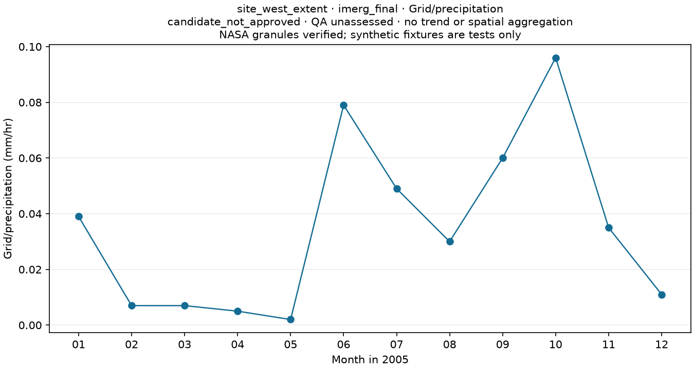
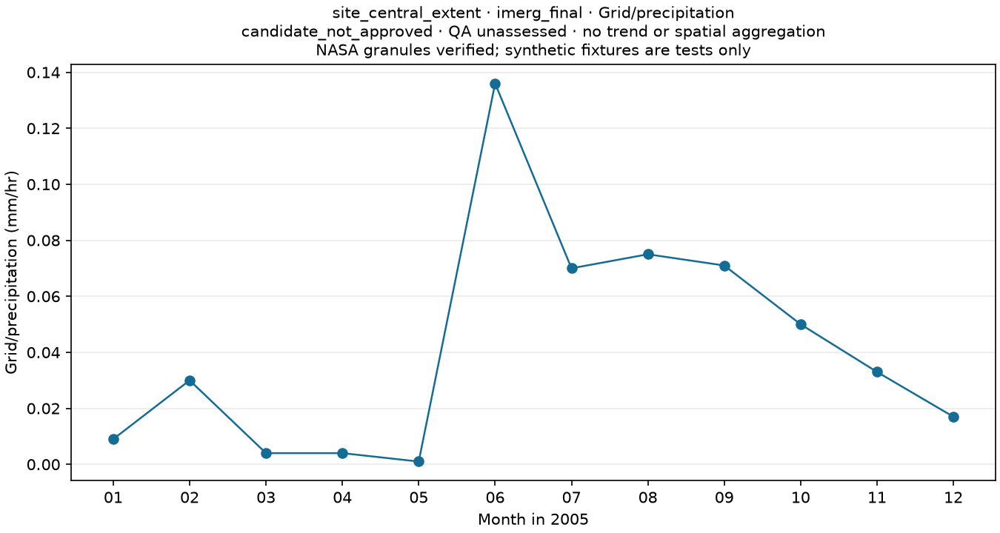
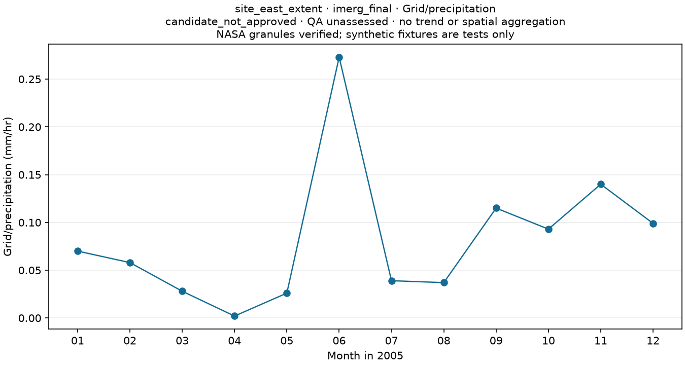
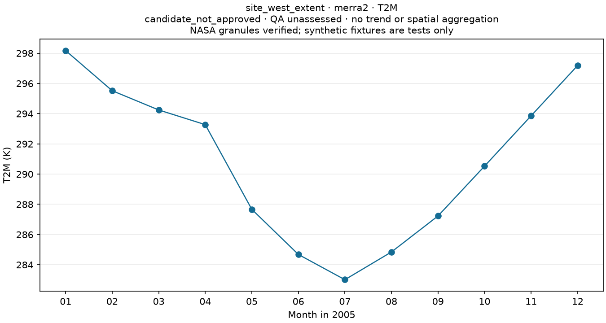
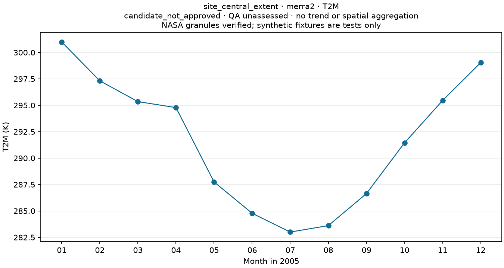
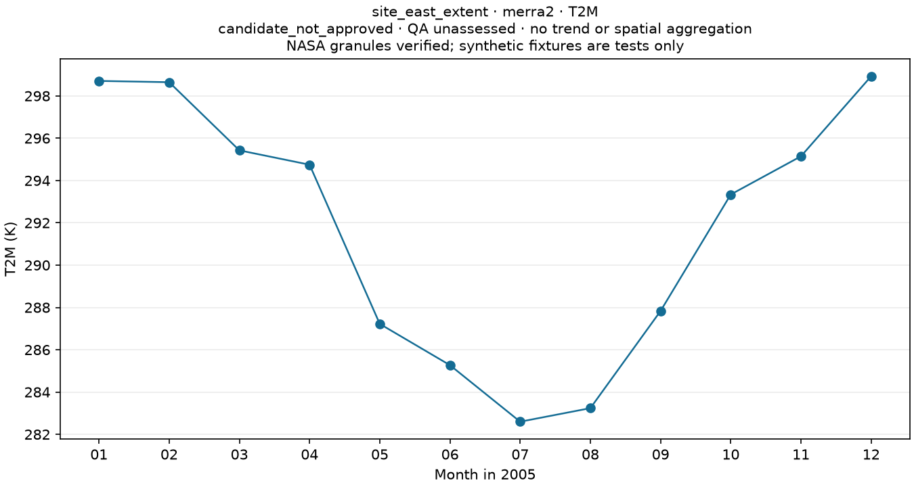
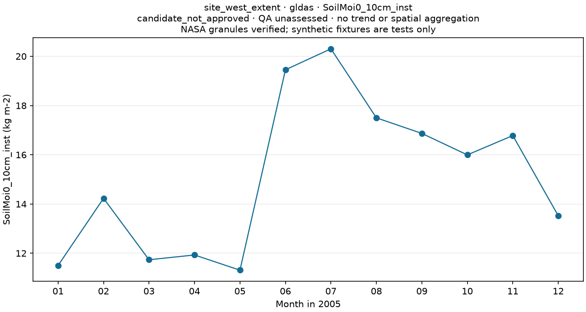
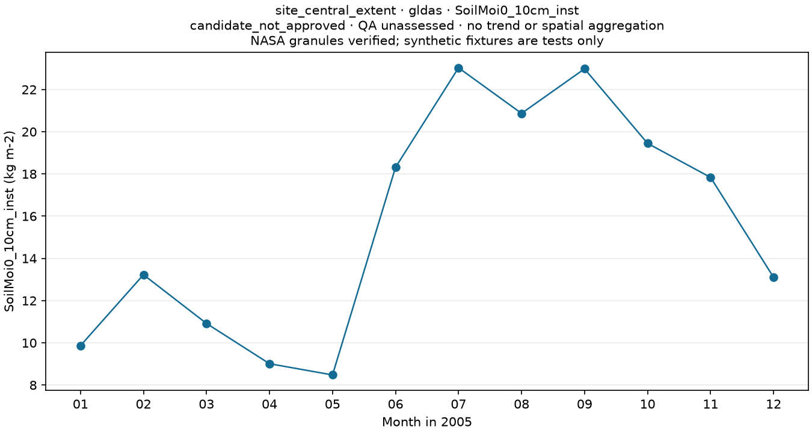
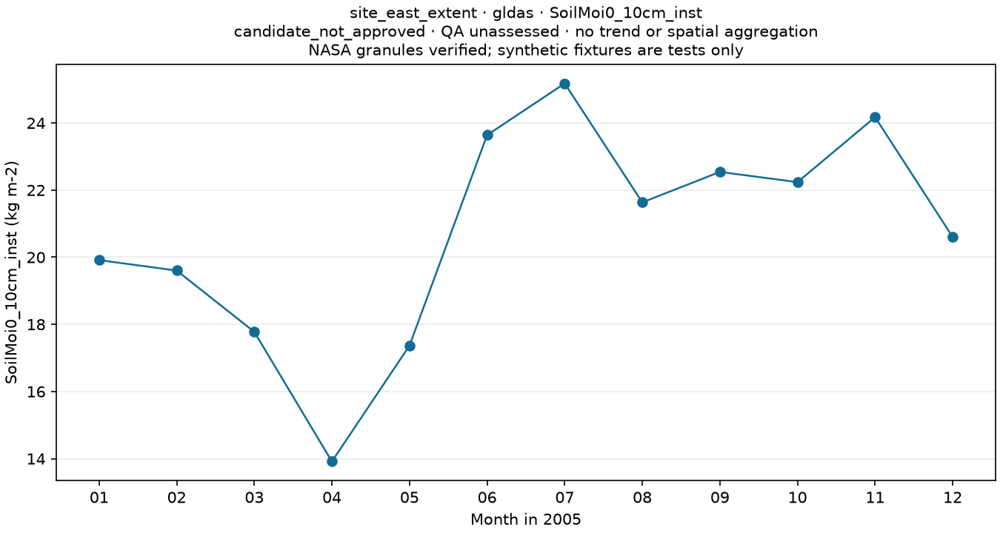

# DS-09 — Ensayo descriptivo puntual NASA 2005

**Tarjeta:** FUL-126 · **Estado:** `diagnostic_only_not_approved` · **Dictamen restringido:** `conditional` para continuar solo con exploración descriptiva puntual, sujeto a decisiones de César.

## Resumen ejecutivo

Se extrajeron **108 observaciones auténticas** (3 sitios candidatos × 3 productos × 12 meses) de 36 granules elegibles del inventario FUL-122. Se reprodujo la auditoría sobre cuatro raíces locales, con 51 archivos candidatos: 36 elegibles (12 por producto) y 15 copias idénticas/rechazadas según la política del inventario. Las 36 identidades, períodos, tamaños, SHA-256, manifests y estructuras nativas fueron revalidados antes de leer celdas; los granules se abrieron en modo solo lectura. La coincidencia temporal triple cubre enero–diciembre de 2005.

Los tres productos conservan grillas, unidades y semánticas diferentes. Todos los valores de las 108 celdas seleccionadas son finitos; en estas celdas y meses no aparecieron fill, NaN, infinito ni meses ausentes. Esto no resuelve QA: **QA IMERG sigue sin evaluar**, el linaje de máscara GLDAS sigue incierto y no se aplicó ningún filtro QA. La coincidencia mensual no demuestra equivalencia de soporte o tiempo. No se calcularon promedios regionales, correlaciones inferenciales, tendencias, anomalías ni modelos. Gate R y Gate T siguen pendientes.

## Reproducibilidad y alcance

Código experimental: [`research/ful126_point_eda.py`](../research/ful126_point_eda.py). Reutiliza el inventario y validación de payloads de `research.ful122_inventory`, lectura de grillas/bounds y validación del límite de `research.ful124_spatial_audit`, y análisis de bounds/soporte de FUL-125. La extracción nueva conserva orden de dimensiones nativo y desactiva el auto mask/scale de NetCDF para clasificar fill antes de decodificar `scale_factor`/`add_offset` una sola vez.

Regenerar desde el repositorio, pasando las carpetas locales en modo solo lectura (no se copian ni incluyen los datos):

```powershell
uv sync --group dev --group research
uv run python -m research.ful126_point_eda `
  --input-dir "RUTA/checkout-original/data/raw/nasa" `
  --input-dir "RUTA/checkout-ful105/data/raw/nasa" `
  --input-dir "RUTA/checkout-ful105/data/cache/ful-105/be02-handoff/data_root/data/raw/nasa" `
  --input-dir "RUTA/checkout-ful123/data/raw/nasa" `
  --boundary-geojson "RUTA/cache-local/mdba_boundary_4326.geojson"
```

El ejecutor no descarga ni modifica los originales. El GeoJSON requerido no se versiona: se valida contra SHA-256 `d36fe31424758cc4fb8eef25e21b835bb5c05c793c746e8a1eb7b5a5841f6a53` y únicamente se usa para el ensayo geométrico controlado autorizado por César. Esa autorización no lo aprueba como máscara, límite de análisis regional ni denominador estadístico. Los datos crudos y rutas locales no se incluyen en Git ni en el manifiesto portátil.

El [manifiesto reproducible](../research/manifests/ful126-point-eda-2005.json) contiene configuración, identidad NASA por mes, versión/variable/unidad, hashes y bytes, hash de manifiesto fuente, grillas, celdas/footprints, valores almacenados/decodificados, metadata temporal, sensibilidad y estado científico. Las tablas de salida contienen metadatos mínimos por fila y no rutas locales.

## Cobertura de inventario

| Producto | Elegibles | Meses | Unidad original | Resolución nominal de celda | Orden nativo |
|---|---:|---|---|---|---|
| IMERG Final V07B · `Grid/precipitation` | 12/12 | 2005-01–2005-12 | `mm/hr` | 0.0999994° lat × 0.0999985° lon | `[1, 3600, 1800]` |
| MERRA-2 M2TMNXSLV 5.12.4 · `T2M` | 12/12 | 2005-01–2005-12 | `K` | 0.5° lat × 0.625° lon | `[1, 361, 576]` |
| GLDAS Noah 2.1 · `SoilMoi0_10cm_inst` | 12/12 | 2005-01–2005-12 | `kg m-2` | 0.25° lat × 0.25° lon | `[1, 600, 1440]` |

Los 15 rechazados no aportan observaciones adicionales: son duplicados o registros no elegibles bajo las reglas verificadas del inventario. La intersección de los meses elegibles de los tres productos es 12/12. “Disponible” aquí significa payload elegible e identidad verificada, no comparabilidad científica.

## Sitios candidatos

Se dividió la extensión proyectada EPSG:3577 del polígono exploratorio en tercios oeste/central/este y se eligió en cada intersección un punto interior determinista (`representative_point` del fragmento recortado). El método distribuye candidatos por la extensión W–E para inspección de sensibilidad; no afirma gradientes hidrológicos ni representatividad. Los tres puntos están cubiertos por el artefacto geométrico autorizado y llevan estado `candidate_not_approved`. Ningún punto de FUL-125 se elevó a sitio definitivo.

| ID | Longitud WGS84 | Latitud WGS84 | Selección / limitación |
|---|---:|---:|---|
| `site_west_extent` | 141.31713489° | -34.26718188° | western extent third; geometría solamente, no sitio hidrológico validado; `candidate_not_approved` |
| `site_central_extent` | 145.93339876° | -33.26978210° | central extent third; geometría solamente, no sitio hidrológico validado; `candidate_not_approved` |
| `site_east_extent` | 149.86027503° | -30.47065970° | eastern extent third; geometría solamente, no sitio hidrológico validado; `candidate_not_approved` |

## Centros y asignación por producto

La regla base selecciona el centro con menor distancia euclidiana en EPSG:3577 entre centros ubicados en una ventana de ±1° alrededor del sitio. No se reproyectan ni interpolan valores; EPSG:3577 se usa solo para comparar centros. El desplazamiento sitio–centro se mide geodésicamente en WGS84. Índices fila latitud/columna longitud son 0-based. Las distancias y bounds son diagnósticos; no significan que las huellas coincidan.

| Sitio | Producto | Índice (fila, columna) | Centro (lon, lat) | Offset sitio-centro | Bounds lon/lat | Bounds / resolución |
|---|---|---|---|---:|---|---|
| `site_west_extent` | IMERG Final V07B | (557, 3213) | (141.349991, -34.250000) | 3.576 km | [141.299988, -34.299999, 141.399994, -34.200001] | 0.1° × 0.1°; native coordinate bounds |
| `site_west_extent` | MERRA-2 M2TMNXSLV 5.12.4 | (111, 514) | (141.250000, -34.500000) | 26.554 km | [140.937500, -34.750000, 141.562500, -34.250000] | 0.5° × 0.625°; inferred from adjacent center midpoints and nominal end spacing |
| `site_west_extent` | GLDAS Noah 2.1 | (102, 1285) | (141.375000, -34.375000) | 13.092 km | [141.250000, -34.500000, 141.500000, -34.250000] | 0.25° × 0.25°; inferred from adjacent center midpoints and nominal end spacing |
| `site_central_extent` | IMERG Final V07B | (567, 3259) | (145.949997, -33.250000) | 2.684 km | [145.899994, -33.299999, 146.000000, -33.200001] | 0.1° × 0.1°; native coordinate bounds |
| `site_central_extent` | MERRA-2 M2TMNXSLV 5.12.4 | (113, 521) | (145.625000, -33.500000) | 38.411 km | [145.312500, -33.750000, 145.937500, -33.250000] | 0.5° × 0.625°; inferred from adjacent center midpoints and nominal end spacing |
| `site_central_extent` | GLDAS Noah 2.1 | (106, 1303) | (145.875000, -33.375000) | 12.874 km | [145.750000, -33.500000, 146.000000, -33.250000] | 0.25° × 0.25°; inferred from adjacent center midpoints and nominal end spacing |
| `site_east_extent` | IMERG Final V07B | (595, 3298) | (149.849991, -30.449999) | 2.494 km | [149.799988, -30.499998, 149.899994, -30.400000] | 0.1° × 0.1°; native coordinate bounds |
| `site_east_extent` | MERRA-2 M2TMNXSLV 5.12.4 | (119, 528) | (150.000000, -30.500000) | 13.804 km | [149.687500, -30.750000, 150.312500, -30.250000] | 0.5° × 0.625°; inferred from adjacent center midpoints and nominal end spacing |
| `site_east_extent` | GLDAS Noah 2.1 | (118, 1319) | (149.875000, -30.375000) | 10.699 km | [149.750000, -30.500000, 150.000000, -30.250000] | 0.25° × 0.25°; inferred from adjacent center midpoints and nominal end spacing |

Las tres grillas difieren en resolución y huella: IMERG ≈0,1°; GLDAS 0,25°; MERRA-2 0,5° × 0,625°. MERRA-2 y GLDAS no declaran bounds lat/lon en los archivos auditados; se infieren desde centros y separación terminal. IMERG aporta bounds de coordenadas nativos. Coordenadas de centro próximas no implican soporte espacial equivalente.

| Sitio | Distancia entre centros IMERG–MERRA-2 | IMERG–GLDAS | MERRA-2–GLDAS |
|---|---:|---:|---:|
| `site_west_extent` | 29.217 km | 14.056 km | 18.007 km |
| `site_central_extent` | 41.030 km | 15.523 km | 27.067 km |
| `site_east_extent` | 15.434 km | 8.655 km | 18.336 km |

## Series observadas y tablas

Cada tabla siguiente presenta una serie por producto en su unidad original. Se exponen lado a lado los tres sitios para describir lecturas puntuales de una misma variable; **no es un panel multivariable validado ni una agregación espacial**. Precisión tabular: 6 cifras significativas; el valor almacenado y el decodificado sin redondear se conservan en el CSV y manifiesto. `finite` significa valor almacenado finito y no identificado como fill.

### IMERG Final V07B — `Grid/precipitation` (mm/hr)

| Mes | Oeste | Centro | Este |
|---|---:|---:|---:|
| 2005-01 | 0.039 | 0.009 | 0.07 |
| 2005-02 | 0.007 | 0.03 | 0.058 |
| 2005-03 | 0.007 | 0.004 | 0.028 |
| 2005-04 | 0.005 | 0.004 | 0.002 |
| 2005-05 | 0.002 | 0.001 | 0.026 |
| 2005-06 | 0.079 | 0.136 | 0.273 |
| 2005-07 | 0.049 | 0.07 | 0.039 |
| 2005-08 | 0.03 | 0.075 | 0.037 |
| 2005-09 | 0.06 | 0.071 | 0.115 |
| 2005-10 | 0.096 | 0.05 | 0.093 |
| 2005-11 | 0.035 | 0.033 | 0.14 |
| 2005-12 | 0.011 | 0.017 | 0.099 |

Conteo para las tres series: finitos 12/12, fill 0, NaN 0, no finitos 0, ausencias 0. QA: no evaluada; no se filtró. Resumen min–max puntual, por sitio, ver manifiesto. CSV descargable por serie: [oeste](../research/results/ful126/site_west_extent_imerg_final_2005.csv), [centro](../research/results/ful126/site_central_extent_imerg_final_2005.csv), [este](../research/results/ful126/site_east_extent_imerg_final_2005.csv).

### MERRA-2 M2TMNXSLV 5.12.4 — `T2M` (K)

| Mes | Oeste | Centro | Este |
|---|---:|---:|---:|
| 2005-01 | 298.178 | 300.996 | 298.708 |
| 2005-02 | 295.522 | 297.318 | 298.648 |
| 2005-03 | 294.246 | 295.349 | 295.426 |
| 2005-04 | 293.275 | 294.783 | 294.747 |
| 2005-05 | 287.669 | 287.743 | 287.221 |
| 2005-06 | 284.684 | 284.778 | 285.27 |
| 2005-07 | 283.012 | 283 | 282.597 |
| 2005-08 | 284.845 | 283.614 | 283.238 |
| 2005-09 | 287.227 | 286.644 | 287.831 |
| 2005-10 | 290.526 | 291.446 | 293.34 |
| 2005-11 | 293.856 | 295.458 | 295.145 |
| 2005-12 | 297.186 | 299.039 | 298.93 |

Conteo para las tres series: finitos 12/12, fill 0, NaN 0, no finitos 0, ausencias 0. QA: no evaluada; no se filtró. Resumen min–max puntual, por sitio, ver manifiesto. CSV descargable por serie: [oeste](../research/results/ful126/site_west_extent_merra2_2005.csv), [centro](../research/results/ful126/site_central_extent_merra2_2005.csv), [este](../research/results/ful126/site_east_extent_merra2_2005.csv).

### GLDAS Noah 2.1 — `SoilMoi0_10cm_inst` (kg m-2)

| Mes | Oeste | Centro | Este |
|---|---:|---:|---:|
| 2005-01 | 11.5028 | 9.86594 | 19.9145 |
| 2005-02 | 14.2317 | 13.2258 | 19.603 |
| 2005-03 | 11.7351 | 10.9175 | 17.7768 |
| 2005-04 | 11.9296 | 9.01023 | 13.9135 |
| 2005-05 | 11.3125 | 8.47855 | 17.3674 |
| 2005-06 | 19.4538 | 18.3125 | 23.6387 |
| 2005-07 | 20.3033 | 23.0281 | 25.1773 |
| 2005-08 | 17.5008 | 20.8692 | 21.6337 |
| 2005-09 | 16.8673 | 22.9788 | 22.542 |
| 2005-10 | 15.9957 | 19.4481 | 22.2372 |
| 2005-11 | 16.7803 | 17.8366 | 24.1723 |
| 2005-12 | 13.5224 | 13.1032 | 20.6027 |

Conteo para las tres series: finitos 12/12, fill 0, NaN 0, no finitos 0, ausencias 0. QA: no evaluada; no se filtró. Resumen min–max puntual, por sitio, ver manifiesto. CSV descargable por serie: [oeste](../research/results/ful126/site_west_extent_gldas_2005.csv), [centro](../research/results/ful126/site_central_extent_gldas_2005.csv), [este](../research/results/ful126/site_east_extent_gldas_2005.csv).

## Gráficos independientes

Cada panel conserva escala y unidad propias. Los gráficos tienen meses en el eje x, no incluyen tendencia ni suavizado, y grafican únicamente la celda de centro más cercano. Los faltantes aparecen como huecos rayados y los ceros válidos se marcan por separado si los hubiese; las 108 observaciones extraídas fueron finitas y no hubo cero en las celdas elegidas. Los fixtures sintéticos solo se usan en tests y no alimentan estas figuras. QA permanece no evaluada.

### IMERG Final V07B (mm/hr)

**site_west_extent**



**site_central_extent**



**site_east_extent**



### MERRA-2 M2TMNXSLV 5.12.4 (K)

**site_west_extent**



**site_central_extent**



**site_east_extent**



### GLDAS Noah 2.1 (kg m-2)

**site_west_extent**



**site_central_extent**



**site_east_extent**



## Sensibilidad espacial

### Centro más cercano frente a contención

Se compararon bounds nativos IMERG, bounds IMERG derivados por puntos medios, e inferidos de los centros para MERRA-2/GLDAS. En los 9 casos sitio-producto cada método encontró exactamente una celda que contiene el punto y fue la misma celda que la regla de centro cercano (9/9 coincidencias). Los bounds IMERG originales y derivados seleccionan la misma celda en los 3/3 puntos. No hubo ambigüedad múltiple ni hueco contenedor en estos puntos, pero esto no valida esos bounds en general ni resuelve los seams IMERG ya documentados en DS-08.

### Celdas adyacentes

Para cada celda base se extrajeron sus cuatro vecinos cardinales (norte/sur/este/oeste) sin envoltura en los extremos de longitud. La tabla resume diferencias exactas entre cada lectura vecina finita y la lectura de celda base para cada mes; delta absoluto queda en la unidad nativa y no es inferencia.

| Sitio | Producto | Comparaciones vecina-mes | Diferentes de la base | Diferente estado | Máxima diferencia absoluta nativa |
|---|---|---:|---:|---:|---:|
| `site_west_extent` | IMERG Final V07B | 48 | 28 | 0 | 0.00399999 `mm/hr` |
| `site_west_extent` | MERRA-2 M2TMNXSLV 5.12.4 | 48 | 48 | 0 | 0.954468 `K` |
| `site_west_extent` | GLDAS Noah 2.1 | 48 | 48 | 0 | 7.95151 `kg m-2` |
| `site_central_extent` | IMERG Final V07B | 48 | 29 | 0 | 0.004 `mm/hr` |
| `site_central_extent` | MERRA-2 M2TMNXSLV 5.12.4 | 48 | 48 | 0 | 0.848846 `K` |
| `site_central_extent` | GLDAS Noah 2.1 | 48 | 48 | 0 | 1.26697 `kg m-2` |
| `site_east_extent` | IMERG Final V07B | 48 | 36 | 0 | 0.006 `mm/hr` |
| `site_east_extent` | MERRA-2 M2TMNXSLV 5.12.4 | 48 | 48 | 0 | 1.63718 `K` |
| `site_east_extent` | GLDAS Noah 2.1 | 48 | 48 | 0 | 6.37982 `kg m-2` |

Estos conteos cuantifican sensibilidad local de celdas, no variabilidad de sitio ni incertidumbre estadística. Para los nueve sitio-producto los cuatro vecinos estuvieron disponibles en los doce meses. Los valores de vecinos, índices, coordenadas, bounds y hashes están en `containment_sensitivity_observations.adjacent_cells_4_neighbor` del manifiesto.

### Diferencias por sitio

Los candidatos se distribuyen entre tercios proyectados distintos; las separaciones entre centros por producto y entre productos por sitio se registran en el manifiesto. Las series puntuales difieren entre sitios y vecinos, lo que evidencia que la elección espacial cambia observaciones. No se seleccionó una ubicación por similitud entre productos.

## Temporalidad, QA y limitaciones científicas

- **IMERG Final V07B:** variable mensual de gránulo `Grid/precipitation`, unidad original `mm/hr`; dimensión nativa `(time, lon, lat)`. Se conserva el valor de tasa almacenado; no se convierte a acumulado. Los gránulos declaran calendario `julian` y límites temporales de mes. QA IMERG no se ha evaluado; variables de calidad/error están presentes y no se aplicaron.
- **MERRA-2 M2TMNXSLV 5.12.4:** `T2M` en `K`; orden `(time, lat, lon)`, 0.5° × 0.625°. El tiempo mensual aparece como `minutes since YYYY-MM-01 00:30:00`; los archivos inspeccionados no declaran calendar ni bounds temporales de variable. No se convierte a Celsius.
- **GLDAS Noah 2.1:** `SoilMoi0_10cm_inst` en `kg m-2`, profundidad nominal indicada por el producto en nombre de variable (0–10 cm), orden `(time, lat, lon)`, 0.25°. `calendar=standard`, bounds de mes y `cell_methods=time: mean`; no se convierte a humedad volumétrica. Bounds espaciales inferidos. El linaje de máscara de agua continúa incierto.
- **Tiempo:** el inventario da etiquetas mensuales coincidentes, pero no se asume que timestamp, calendario, averaging/cell methods ni huellas temporales sean equivalentes. La etiqueta mensual común no basta para análisis conjunto.
- **Valores ausentes:** en las 108 lecturas base no hubo marcadores fill, NaN, infinitos ni faltantes mensuales. El código distingue esos estados explícitamente y clasifica fill antes de escala/offset. Los valores negativos finitos quedan en categoría `negative_finite_review`, sin filtrado.
- **Fill, escalas y unidades:** los atributos por archivo se conservan en el manifiesto. No se encontraron transformaciones de unidades aplicadas; si hubiera scale/offset nativos, se registra raw almacenado y decoded con aplicación única. Precisión nativa y forma de grilla permanecen en trazabilidad.
- **Espacial:** distancia de centros, resolución y bounds difieren por producto; MERRA-2/GLDAS bounds son estimados. Datum/linaje posicional exacto de la geometría MDBA actual no está resuelto. No se probó equivalencia de muestreo espacial.
- **QA/representatividad:** los sitios son candidatos geométricos, no estaciones observadas ni ubicaciones hidrológicamente justificadas. El límite se usa solo para elegir/comprobar candidatos del ensayo; no para enmascaramiento o estadística regional.

## Dictamen restringido y decisiones pendientes

**`conditional` para continuar con exploración descriptiva puntual solamente.** Se demuestra extracción trazable de tres variables NASA en 12 meses, con sensibilidad local visible. No habilita EDA multivariable inferencial ni una interpretación conjunta. Para seleccionar sitios definitivos y construir una EDA multivariable defendible, César debe decidir/autorizar: (1) justificación hidroclimática independiente de los sitios; (2) artefacto MDBA y precisión/datum adecuados a esa selección; (3) criterio de correspondencia espacial y tratamiento de resolución/huella; (4) compatibilidad temporal/semántica de cada variable; (5) QA IMERG, manejo de missing y máscara/linaje GLDAS; (6) Gate R y Gate T mediante sus evidencias requeridas.

No se aprueba ningún sitio, máscara, estrategia de co-localización, QA, Gate R, Gate T, correlación, tendencia o modelo. No se convierten los 108 valores en una tabla de entrenamiento o un panel científicamente comparable.

## Artefactos y validación

- Manifiesto: [`research/manifests/ful126-point-eda-2005.json`](../research/manifests/ful126-point-eda-2005.json).
- Código: [`research/ful126_point_eda.py`](../research/ful126_point_eda.py).
- Pruebas offline sintéticas: [`research/tests/test_ful126_point_eda.py`](../research/tests/test_ful126_point_eda.py).
- Tablas por sitio/producto: `research/results/ful126/` (9 CSV).
- Figuras por sitio/producto: `research/figures/ful126/` (9 PNG).
- Las pruebas usan fixtures creadas al vuelo y explícitamente sintéticas; no reemplazan ni se mezclan con el inventario NASA real.

Al finalizar la rama se ejecutan los comandos completos requeridos: `uv run pytest backend/tests research/tests -q`, `uv run ruff check backend research` y `git diff --check`. El resultado y CI se registrarán en la PR.
