# FE-03 · Experiencia de usuario de `/explore`

**Estado:** propuesta de diseño para revisión de César. **No está aprobada** y no implementa nada.
**Tarjeta:** FUL-118 (FE-03). **Depende de:** contrato AZ-04 v0 (`0.1-draft`, borrador no aprobado). Con `dev` en `884c34f` están implementados `GET /regions`, `GET /products` (BE-03) y `GET /series` (BE-04); `/analyses` y `raster_layers` no (sección 4.1).
**Alcance:** solo documentación y wireframes. La implementación de `/explore` es FE-04 (FUL-119) y queda bloqueada hasta que César apruebe FE-03 y FE-05.
**Autora:** Alejandra Reyes (frontend). **Revisión científica:** César. **Compatibilidad con la API:** Alaín.

> Todo lo que aparece en los wireframes es estructural o sintético. Los únicos números son 0,42 y 0 del ejemplo oficial `pointSample` de `docs/openapi-contract-v0.yaml`. Ninguna cifra es una observación NASA ni un resultado estadístico. Donde el estado real necesitaría un valor de la API, el wireframe muestra un marcador como ‹valor›.

## 1. Resumen

`/explore` deja elegir una región, una variable NASA y un rango de meses, y muestra la serie mensual con su fuente, su unidad, su calidad y hasta dónde llega su interpretación. En la versión actual del contrato:

- La serie real disponible es una **muestra de un punto** (`point_sample`) de IMERG 2005, no un promedio de cuenca.
- No hay método estadístico aprobado: el análisis de tendencia siempre aparece como **no disponible**.
- La API todavía no publica capas de mapa: el backend no incluye `raster_layers` en ninguna respuesta. El mapa debe saber mostrar su ausencia sin inventar una imagen.

El documento define: el flujo de la pantalla (sección 3), los 10 estados con sus wireframes (secciones 4 y 5), qué campo del OpenAPI alimenta a qué componente (sección 6), los 15 componentes con sus props (sección 7), el texto literal en español (sección 8), accesibilidad (sección 9), diferencias y huecos del contrato para César (sección 11) y las decisiones que dependen de él (sección 12).

**Qué NO hace este documento:** no elige librerías (eso es FE-05), no implementa `/explore` (eso es FE-04), no modifica el contrato y no declara aprobado el flujo.

### Archivos de este entregable

| Archivo | Qué es |
|---|---|
| `docs/fe-03-explorer-ux.md` | Este documento |
| `docs/fe-03/wireframes.html` | Los wireframes de todos los estados, escritorio y móvil, autocontenido (se abre con doble clic) |
| `docs/fe-03/E1-desktop.png` ... `E10-mobile.png` | Capturas de cada estado (20 imágenes) |
| `docs/fe-03/validar_ejemplos.py` | Valida los ejemplos JSON (oficiales, observados y derivados) contra el OpenAPI |
| `docs/fe-03/ejemplos-observados/*.json` | Respuestas reales del backend de `dev` (capturas), usadas como ejemplos y validadas contra el OpenAPI |

### Fuentes de verdad usadas

`docs/openapi-contract-v0.yaml` (contrato), `docs/contracts-v0.md` (reglas de error y estados), `docs/alcance-cientifico-provisional.md`, `docs/ds-03-snapshot-imerg-demo.md` (serie real IMERG 2005), `docs/region_murray_darling.md`, `docs/backend-catalog-v1.md` y `docs/be-04-snapshot-reader.md` (lo que el backend de `dev` responde de verdad), `docs/fe-05-evaluacion-mapa-graficos.md` (evaluación de mapa y gráficos) y los tokens de la landing (`frontend/src/styles/tokens.css`).

## 2. Reglas que gobiernan el diseño

Estas reglas salen del alcance científico y del contrato. Si un wireframe las contradice, el wireframe está mal.

1. **`synthetic: true` siempre se ve.** `MockDataNotice` es un banner que no se puede cerrar ni ocultar mientras `synthetic` sea `true`. Con `synthetic: false` no se muestra.
2. **`null` no es cero.** Un mes con `value: null` es un hueco ("Sin dato"). Un `0` es un valor válido y se dibuja como punto en 0. En el gráfico, el hueco corta la línea; en la tabla dice "Sin dato".
3. **mm/hr es una tasa, no un acumulado.** IMERG mensual es la precipitación media expresada como tasa. Siempre se rotula "tasa media mensual" y nunca se suma ni se presenta como total del mes.
4. **Una serie `point_sample` no es el promedio de la región.** Se rotula "Muestra NASA exploratoria" y "Serie de un solo punto". El agregado regional aparece como no aprobado.
5. **Calidad `unassessed` se dice tal cual.** No se muestra una "calidad buena" ni un check verde. `verification_state: basic_checks_only` significa solo controles básicos de estructura y de valores no finitos o de relleno.
6. **Sin análisis no hay cifras.** Con `409 ANALYSIS_METHOD_UNAVAILABLE` no se dibuja curva de tendencia ni se muestra pendiente, intervalo de confianza o valor p. Todas las métricas son `null`.
7. **Ausencia honesta en el mapa.** Si no hay capa para un mes, el mapa lo dice. No muestra la capa de otro mes en su lugar ni una imagen de relleno.
8. **No se dibuja una cuenca que la API no entrega.** `Region` no trae geometría (solo `geometry_version`, `geometry_source`, `crs`, `area_km2`). No se usa el `LineString` de demostración como polígono de cuenca. Murray-Darling es una región **propuesta**, no aprobada.
9. **Sin tooltips por celda.** El contrato no entrega valores por píxel. El mapa no inventa interacción por celda.
10. **El código de error guía la interfaz; el mensaje del servicio es informativo** (`docs/contracts-v0.md`). La interfaz tiene su propio texto por `code` y puede mostrar el mensaje del servicio como detalle secundario.
11. **Un error técnico nunca se disfraza de "sin datos".** 503 y 500 no son `no_data`.
12. **La aprobación científica es de César.** Ni este documento ni la pantalla afirman que algo esté validado.

## 3. Flujo de `/explore`

```
Entrada a /explore
   │
   ├─ GET /regions ─────────────┬─ 200, regions = []   → E1 (sin regiones publicadas)
   │                            ├─ 200, regions ≥ 1    → se habilita Región
   │                            └─ 503 / 500           → E5 (error con reintento)
   │
   ▼
Elegir Región ── GET /products?region_id ──┬─ 200, products ≥ 1 → se habilita Variable NASA
                                           ├─ 200, products = [] → aviso "sin productos"
                                           ├─ 404                → E4 (no encontrado)
                                           └─ 503 / 500          → E5
   │
   ▼
Elegir Variable + rango de meses (Desde, Hasta) ──► botón "Ver serie"
   │   validación local: formato AAAA-MM, Desde ≤ Hasta, máximo 240 meses
   │
   ▼
GET /series?region_id&product_id&start&end&frequency=monthly
   │
   ├─ 200 data_state = available_with_gaps ─► E2  (gráfico + tabla + huecos + mapa si hay capa)
   ├─ 200 data_state = available            ─► igual que E2, sin aviso de huecos
   ├─ 200 data_state = no_data              ─► E3  (no es un error)
   ├─ 404 RESOURCE_NOT_FOUND                ─► E4
   ├─ 422 INVALID_PARAMETER / PERIOD_OUT_OF_COVERAGE / LIMIT_EXCEEDED ─► E4
   ├─ 503 SERVICE_UNAVAILABLE (retryable)   ─► E5
   └─ 500 INTERNAL_ERROR                    ─► E5 (sin botón de reintento)
   │
   ▼
Con una serie 200:
   ├─ raster_layers ausente o todas "unavailable" ─► E6 (mapa en ausencia honesta)
   ├─ raster_layers mezcladas                     ─► E9 (mes con capa) / E10 (mes sin capa)
   └─ el análisis de tendencia se muestra como "no disponible" (E7); no se calcula nada
```

**Reglas de navegación**

- Cambiar Región reinicia Variable, rango y mes seleccionado. Cambiar Variable o rango descarta la serie anterior (no se muestra una serie vieja bajo filtros nuevos).
- El mes seleccionado del mapa es una elección del usuario y no avanza solo. "Reproducir" solo existe si hay al menos 2 meses con capa disponible y el usuario lo pulsa.
- Los filtros viven en la URL para poder compartir una vista: `/explore?region=murray-darling-basin&product=P02&start=2005-01&end=2005-03&month=2005-01`. Al entrar con una URL, los parámetros se validan igual que si los hubiera escrito la persona. *Decisión pendiente de César (D6).*
- Mientras `GET /series` no responda, la pantalla muestra carga (esqueleto) en las zonas de resultado, no un spinner a pantalla completa. Los filtros siguen visibles.

## 4. Mapa de estados

| Id | Estado | Qué lo provoca en la API | Captura |
|---|---|---|---|
| **E1** | Sin regiones publicadas | `GET /regions` → `200` con `regions: []` (derivado; `dev` no lo produce) | `E1-desktop.png`, `E1-mobile.png` |
| **E2** | Serie sintética con huecos, cero y gráfico | `GET /series` → `200`, `data_state: available_with_gaps`, `synthetic: true` (ejemplo oficial `pointSample`) | `E2-*` |
| **E3** | Sin datos para el rango | `GET /series` → `200`, `data_state: no_data` (ejemplo oficial `noData`) | `E3-*` |
| **E4** | Filtros inválidos o recurso inexistente | `422 INVALID_PARAMETER` (ejemplo oficial) y `404 RESOURCE_NOT_FOUND` (observado en `dev`) | `E4-*` |
| **E5** | Servicio no disponible | `503 SERVICE_UNAVAILABLE`, `retryable: true` (ejemplo oficial); variantes 500 y sin red | `E5-*` |
| **E6** | Capa de mapa no disponible | `200` con `raster_layers` ausente (lo que sirve `dev`) o con `raster_layers[*].state: unavailable` (derivado del esquema) | `E6-*` |
| **E7** | Análisis no disponible | `POST /analyses` → `409 ANALYSIS_METHOD_UNAVAILABLE` (ejemplo oficial; `/analyses` aún no existe en `dev`) | `E7-*` |
| **E8** | Datos reales con soporte puntual (IMERG 2005) | `200`, `synthetic: false`, `support_type: point_sample`, `mm/hr` | `E8-*` |
| **E9** | Capas mixtas, mes con capa | `raster_layers` mezcladas, mes seleccionado `available` (derivado) | `E9-*` |
| **E10** | Capas mixtas, mes sin capa | igual, mes seleccionado `unavailable` (derivado) | `E10-*` |

Los estados E1 a E7 son los siete obligatorios de la tarjeta. E8 es la actualización de integración del 15-11 (serie real IMERG 2005). E9 y E10 no estaban pedidos: los agrego porque FE-04 necesita ver cómo luce el mapa **cuando sí hay capa** y cómo se ausenta un solo mes. Son ejemplos derivados y los marco así.

**Estados auxiliares sin wireframe propio** (misma estructura que otro estado, cambia el texto):

| Situación | Tratamiento |
|---|---|
| Cargando regiones, productos o serie | Esqueleto en la zona que espera; filtros visibles; `aria-busy="true"` en la zona |
| `GET /products` con `products: []` | Variable queda deshabilitada con el aviso "Esta región todavía no tiene productos publicados." |
| `500 INTERNAL_ERROR` | Como E5, sin botón "Reintentar" (`retryable: false`) |
| Sin respuesta de la red (la petición falla sin cuerpo) | Como E5, con texto propio y "Reintentar". El contrato no define este caso |
| `422 PERIOD_OUT_OF_COVERAGE` y `422 LIMIT_EXCEEDED` | Como E4, con el texto del catálogo (sección 8) |
| `data_state: available` (serie completa) | Como E2 sin aviso de huecos; la insignia dice "Serie completa" |
| `spatial_aggregation.support_type: descriptive_mean` o `regional_aggregate` | Variante de `SourceProvenance` y `CoverageSummary` descrita en la sección 7; sin wireframe porque no hay ejemplo oficial |

### 4.1 Qué produce hoy el backend de `dev` (`884c34f`)

Lo comprobé ejecutando la aplicación con `TestClient` (con y sin snapshot sintético) y leyendo `backend/app`. Las respuestas capturadas están en `docs/fe-03/ejemplos-observados/`.

| Estado | ¿Lo produce hoy? | Detalle |
|---|---|---|
| **E1** | No | `GET /regions` publica siempre una región (`murray-darling-basin`). El estado queda como defensa ante un catálogo vacío. |
| **E2** | Solo con un snapshot sintético | El backend sirve `synthetic: true` solo si se configura un snapshot sintético (así lo hacen sus pruebas). Con el snapshot real sirve E8. |
| **E3** | Sí, es el estado por defecto | Sin snapshot configurado, toda consulta válida de hasta 240 meses responde `200 no_data`, para cualquier producto y período. Con snapshot, `no_data` es lo que responden `P01` y `P03`. |
| **E4** | Sí | `404 RESOURCE_NOT_FOUND`, `422 INVALID_PARAMETER`, `422 LIMIT_EXCEEDED` y `422 PERIOD_OUT_OF_COVERAGE` (este último solo con snapshot). `details` viene siempre `null` (O5). |
| **E5** | Sí | `503 SERVICE_UNAVAILABLE` (reintentable) si se configura un snapshot que no se puede leer; `500 INTERNAL_ERROR` si el snapshot es ilegible o inconsistente. |
| **E6** | Sí, con `raster_layers` ausente | El backend no incluye `raster_layers`. No produce descriptores `unavailable` explícitos. |
| **E7** | No | `/analyses` no existe: responde `404` con `{"detail": "Not Found"}`, que no es un sobre de error del contrato (O13). |
| **E8** | Sí, con el snapshot real | `synthetic: false`, `point_sample`. Requiere configurar `ANOMALY_ZERO_IMERG_SNAPSHOT` con un snapshot verificado; los datos reales no están en Git. |
| **E9**, **E10** | No | Requieren que el backend publique `raster_layers`. |

## 5. Wireframes

Cada estado tiene versión de escritorio (1200 px) y móvil (390 px). La franja amarilla superior de cada captura indica qué respuesta del API la provoca y no es parte de la interfaz. Las etiquetas punteadas con nombre en monoespaciado son los componentes de la sección 7. El archivo `docs/fe-03/wireframes.html` contiene todos los estados juntos.

Las tipografías de los wireframes son de respaldo (Georgia y la fuente del sistema) para que el HTML sea autocontenido; la landing usa Fraunces e IBM Plex. Colores, espacios y radios son los tokens de la landing.

**Orden en móvil:** Filtros → estado de la serie → gráfico → mapa → tabla → cobertura → calidad → procedencia → análisis. El gráfico va antes que el mapa porque es la pieza que siempre existe; el mapa puede estar ausente. La tabla de la serie se convierte en una tarjeta por mes (sin desplazamiento horizontal).

### E1 · Sin regiones publicadas
`GET /regions` devuelve `regions: []`. No hay mapa ni región inventada. Los filtros quedan deshabilitados y se explica por qué. El backend actual no lo produce (publica siempre una región); queda como defensa ante un catálogo vacío.

| Escritorio | Móvil |
|---|---|
| 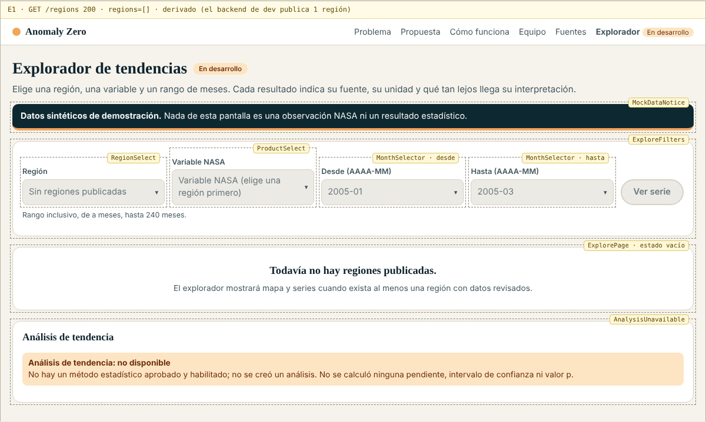 | 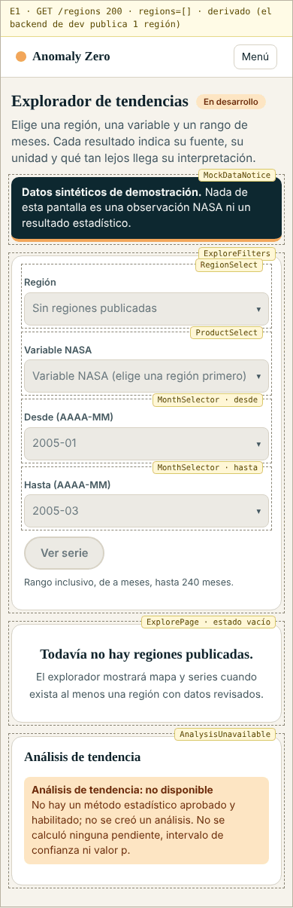 |

### E2 · Serie sintética con huecos, cero y gráfico
Ejemplo oficial `pointSample`: enero 0,42, febrero `null` (`provider_fill_value`), marzo 0. Muestra los tres casos que no se pueden confundir: valor, hueco y cero. El mapa está en ausencia honesta (sin capa) y no se dibuja leyenda de color para algo que no se muestra.

| Escritorio | Móvil |
|---|---|
| 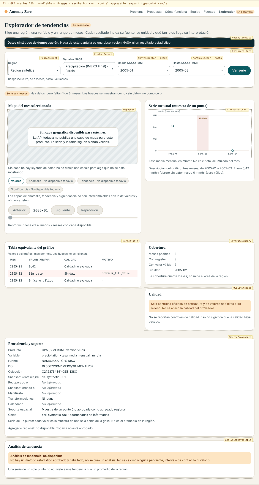 | 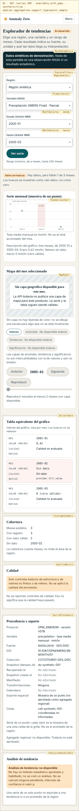 |

### E3 · `200` con `no_data`
La consulta fue válida y no devolvió meses. No es un error: no hay gráfico ni tabla, la cobertura dice 0 de 3 meses con valor y la procedencia muestra "No informado" donde la API devuelve `null` (`dataset_id`, `provenance`).

| Escritorio | Móvil |
|---|---|
|  | 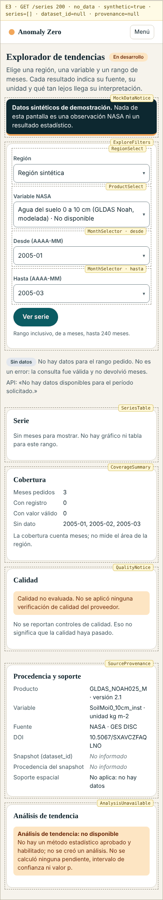 |

### E4 · `404` y `422`
Se corrige el filtro; no hay reintento porque repetir la misma petición no cambia el resultado (`retryable: false`). El control con problema se marca desde la validación local del formulario y, según el `code`, desde el grupo de controles afectado (`LIMIT_EXCEEDED` y `PERIOD_OUT_OF_COVERAGE` marcan «Desde» y «Hasta»). Si la respuesta trae `details.field` (el ejemplo oficial lo trae) se usa para marcar el control exacto, pero el backend actual envía `details: null` (O5): la interfaz no depende de él. El mensaje del servicio queda como detalle.

| Escritorio | Móvil |
|---|---|
| 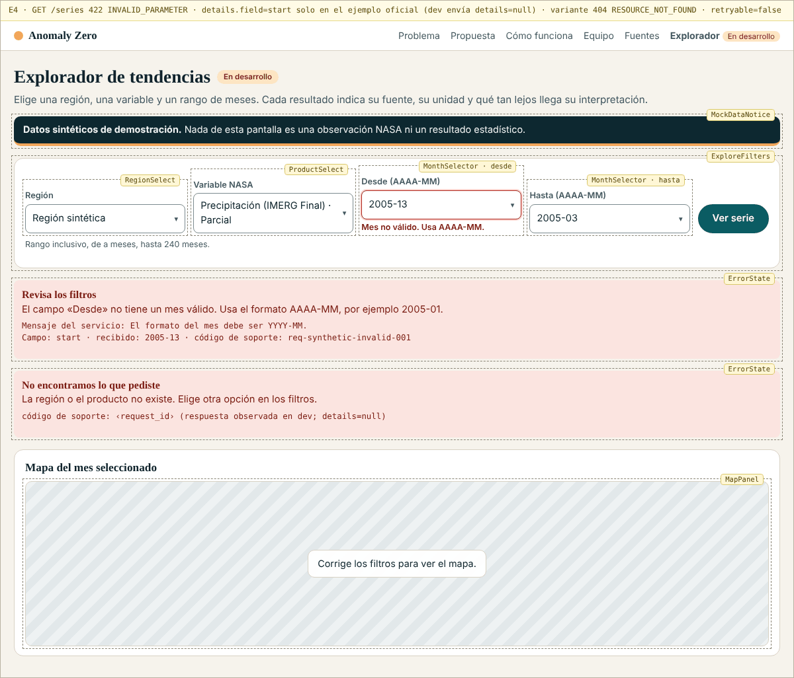 | 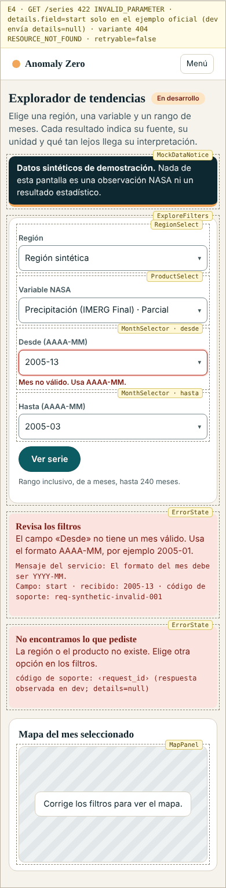 |

### E5 · `503` con reintento
El servicio tuvo un problema temporal (`retryable: true`). La página no se rompe, los filtros siguen funcionando y el botón "Reintentar" es accesible por teclado. El texto aclara que esto no significa que no haya datos.

| Escritorio | Móvil |
|---|---|
| 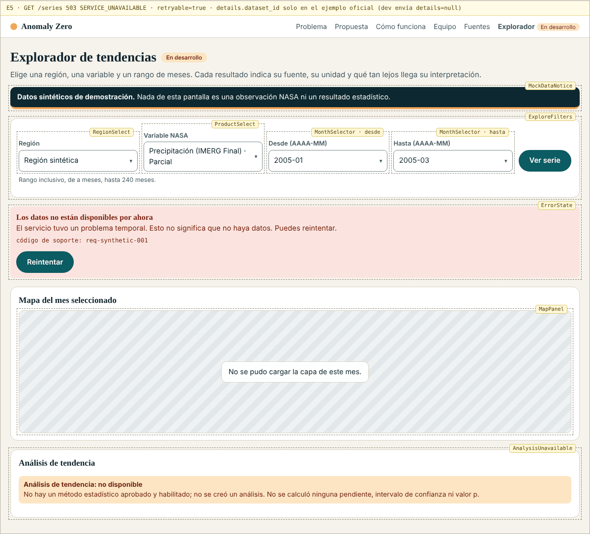 | 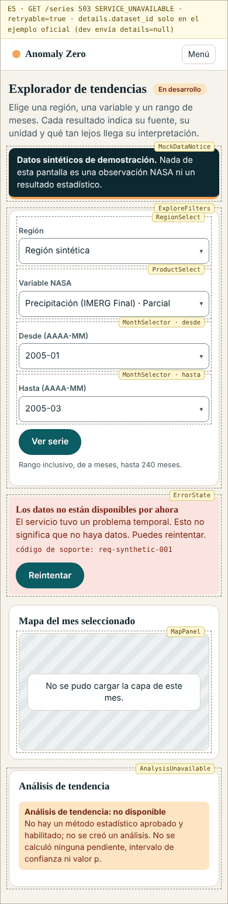 |

### E6 · `raster_layers` con `state: unavailable`
Cubre dos casos con la misma interfaz: `raster_layers` ausente (lo que sirve hoy el backend) y descriptores con `state: unavailable` (derivado del esquema). Sin capa no se piden tiles, la línea de tiempo queda deshabilitada y las capas de anomalía, tendencia y significancia aparecen como "No disponible todavía". La serie y la tabla siguen siendo válidas.

| Escritorio | Móvil |
|---|---|
|  | 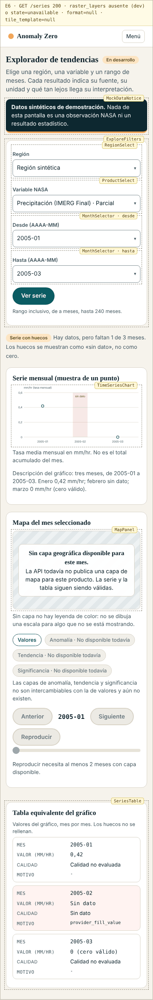 |

### E7 · `409 ANALYSIS_METHOD_UNAVAILABLE`
No se creó ningún análisis (`analysis_id: null`, `method: null`) y todas las métricas son `null`. La interfaz lo dice y no dibuja curva ni cifras de ejemplo. `POST /analyses` aún no existe en el backend (O13): el wireframe corresponde al ejemplo oficial del contrato.

| Escritorio | Móvil |
|---|---|
| 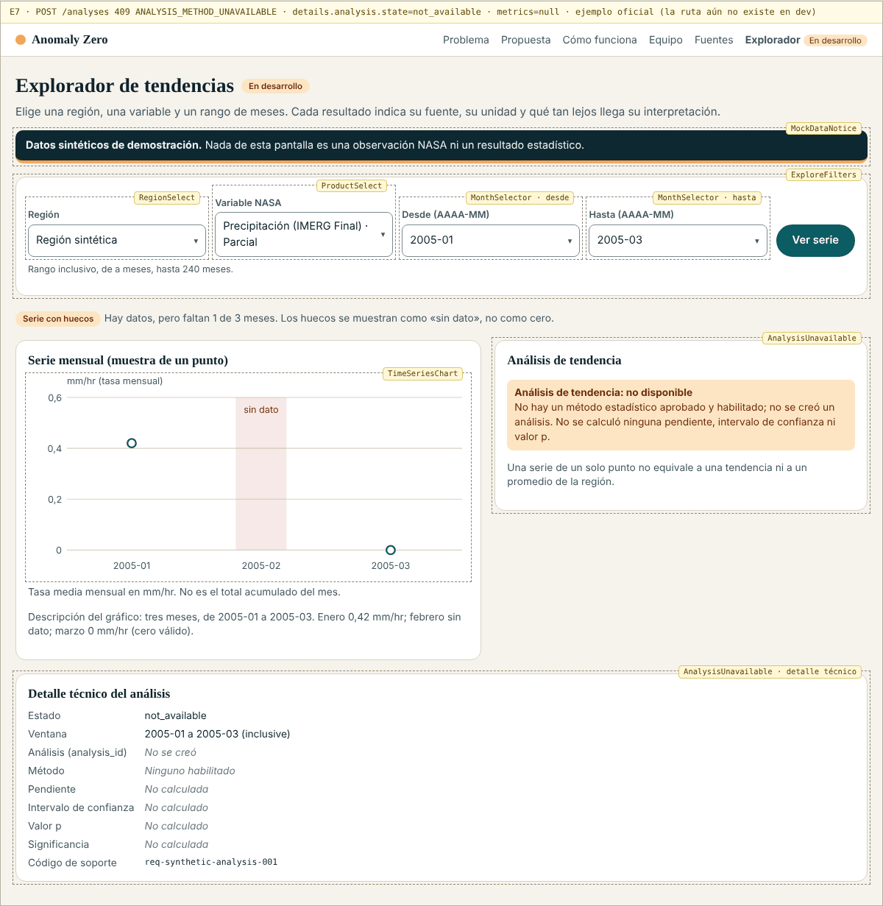 | 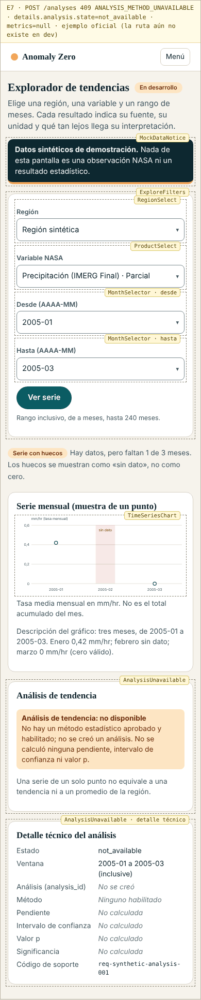 |

### E8 · Datos reales con soporte puntual (IMERG 2005)
`synthetic: false`, por eso **no** aparece `MockDataNotice`. Muestra la estructura de la serie real de DS-03: 12 meses de 2005, un solo punto (`point_sample`), `mm/hr` como tasa, calidad no evaluada, fuente y DOI, identificador de celda, `null` distinto de cero y los límites de interpretación. **El wireframe no trae cifras**: los valores se muestran como ‹valor›. Los 12 valores reales viven en el snapshot local de DS-03 (archivos derivados que Git ignora) y no se copian a este documento.

Lo que `docs/be-04-snapshot-reader.md` documenta sobre ese punto y que la pantalla debe mostrar tal cual venga de la API: `cell_id` `IMERG-v07b-center-lon3257-lat523`, latitud -37,65 (-37.64999771118164), longitud 145,75, rotulado "muestra NASA exploratoria". El identificador del panel FUL-105 (`ful105-panel-row-001`) no forma parte de la respuesta de la API (O9). El backend toma `product_version` del snapshot (`V07B` en sus pruebas), mientras que `/products` sin snapshot informa la colección `07` (O15). La procedencia de esta serie trae un hash por archivo de origen (`source_sha256`, 12) y `original_file_count`; el resto de los campos de `provenance` vienen `null`.

| Escritorio | Móvil |
|---|---|
| 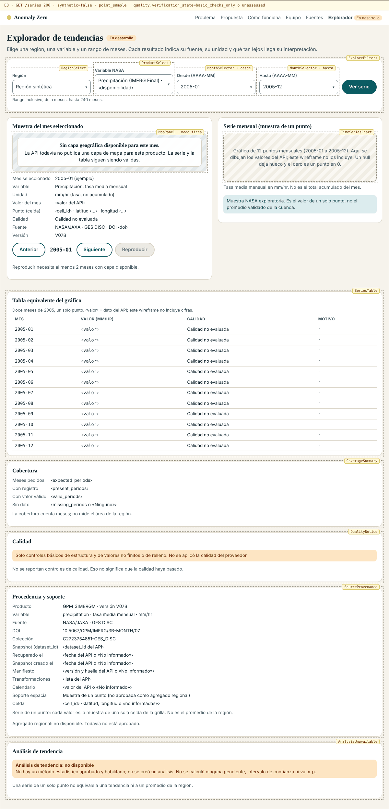 | 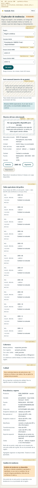 |

### E9 y E10 · Capas mixtas (ejemplo derivado)
El OpenAPI no trae ningún ejemplo de `raster_layers` y el backend actual no las publica. Este ejemplo se deriva del esquema `RasterLayer`: enero y marzo `available`, febrero `unavailable`. E9 muestra el mes con capa (leyenda, línea de tiempo habilitada); E10 muestra el mes sin capa: el mapa lo dice y no muestra la capa de otro mes.

| E9 escritorio | E9 móvil |
|---|---|
|  | 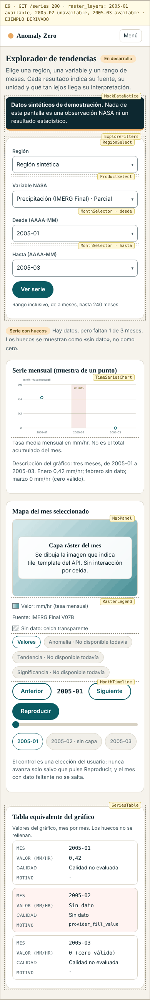 |

| E10 escritorio | E10 móvil |
|---|---|
|  | 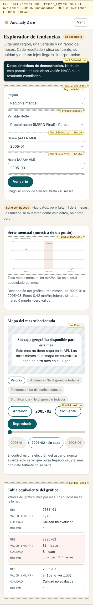 |

## 6. Matriz: campo del OpenAPI → componente → visibilidad

Lectura: cada fila dice qué campo del contrato se muestra, dónde, cuándo, qué se ve cuando no hay valor y qué estado lo ilustra. "Vacío" es lo que ve la persona cuando el campo es `null`, `[]` o falta. Nunca se muestra "null", "undefined" ni una cadena vacía.

**Convenciones:** `P` = ejemplo `pointSample`, `N` = ejemplo `noData`. Los textos entre «» son los literales de la sección 8.

### 6.1 Envelope y regiones

| Campo | Componente | Visible cuando | Vacío | Copy literal | Estado |
|---|---|---|---|---|---|
| `Envelope.synthetic` | `MockDataNotice` | `true` (siempre, no ocultable) | `false`: no se renderiza | «Datos sintéticos de demostración. Nada de esta pantalla es una observación NASA ni un resultado estadístico.» | E1 a E7, E9, E10 |
| `Envelope.contract_version` | `SourceProvenance` (pie, en detalle técnico) | siempre | n/a (obligatorio) | «Versión del contrato: 0.1-draft» | todos con serie |
| `Envelope.generated_at` | `SourceProvenance` (pie) | siempre | n/a (obligatorio) | «Respuesta generada el ‹fecha›» | todos con serie |
| `RegionsResponse.regions[]` | `RegionSelect` | `length ≥ 1` | `[]` → control deshabilitado y `ExplorePage` muestra el vacío | «Todavía no hay regiones publicadas.» | E1 |
| `Region.region_id` | `RegionSelect` (valor de la opción) | siempre | n/a | (no se muestra) | E2 |
| `Region.name` | `RegionSelect` (texto de la opción) | siempre | n/a | «Región sintética» (P) | E2 |
| `Region.area_km2` | `RegionSelect` (texto secundario) | no `null` | se omite la línea | «Área: ‹n› km²» | (sin ejemplo con valor; el backend real lo envía `null`) |
| `Region.geometry_version`, `geometry_source`, `crs` | `SourceProvenance` | cada uno por separado, si no es `null` | cada `null` → «No informado» | «Geometría: versión ‹versión› · CRS ‹CRS› · fuente ‹enlace›» | E2 (todos `null` en P y N); en el backend real solo `geometry_source` trae valor (un enlace al ítem oficial de la MDBA) |

### 6.2 Productos

| Campo | Componente | Visible cuando | Vacío | Copy literal | Estado |
|---|---|---|---|---|---|
| `ProductsResponse.products[]` | `ProductSelect` | `length ≥ 1` | `[]` → control deshabilitado | «Esta región todavía no tiene productos publicados.» | auxiliar |
| `Product.product_id` | `ProductSelect` (valor) | siempre | n/a | (no se muestra) | E2 |
| `Product.short_name`, `variable` | `ProductSelect` (etiqueta) y `SourceProvenance` | siempre | n/a | «Precipitación (IMERG Final)» etiqueta; «GPM_3IMERGM» y «precipitation» en procedencia | E2, E3 |
| `Product.product_version` | `SourceProvenance` | siempre | n/a; se muestra tal cual llegue (O15) | «versión V07B» | E2 |
| `Product.quantity` | `SourceProvenance` y `TimeSeriesChart` (rótulo del eje) | siempre | n/a | «tasa media mensual» (IMERG) | E2 |
| `Product.unit` | `TimeSeriesChart`, `SeriesTable`, `RasterLegend`, `SourceProvenance` | siempre | n/a | «mm/hr» · «kg m-2» · «K» | E2, E3 |
| `Product.availability` (`available`, `partial`, `unavailable`) | `ProductSelect` (estado entre paréntesis en cada opción) | siempre | n/a | «Disponible» · «Parcial» · «No disponible» | E2 (P: `partial`), E3 (N: `unavailable`) |
| `Product.current_dataset_id` | (no se muestra; es la clave para pedir un análisis) | no `null` (P: `ds-synthetic-001`; N: `null`) | se omite | n/a | n/a |
| `Product.coverage` (`MonthRange`) | `ProductSelect` (ayuda) y límites de `MonthSelector` | no `null` (P: 2005-01 a 2005-03; N: `null`) | no se limita el rango en el control | «Cobertura publicada: 2005-01 a 2005-03» (P) | E2 |
| `Product.quality` | `QualityNotice` (si la serie no la trae) | no `null` | se usa `SeriesResponse.quality` | ver 6.5 | n/a |
| `Source.agency`, `distributor` | `SourceProvenance` | `agency` siempre; `distributor` no `null` | se omite `distributor` | «NASA · GES DISC» | E2, E3 |
| `Source.collection_id` | `SourceProvenance` | no `null` | «No informado» | «Colección: C2723754851-GES_DISC» (P) | E2 |
| `Source.doi` | `SourceProvenance` (enlace) | no `null` | «No informado» | «DOI: 10.5067/GPM/IMERG/3B-MONTH/07» (P) | E2, E3 |
| `Source.source_urls[]` | `SourceProvenance` (lista de enlaces) | `length ≥ 1` | `[]` → se omite la lista | «Enlaces de la fuente» | (vacío en N) |
| `Source.granule_ids[]` | `SourceProvenance` (detalle plegable) | `length ≥ 1` | `[]` → se omite | «Gránulos de origen (‹n›)» | (vacío en N) |

En el backend de `dev`, los tres productos (`P01` MERRA-2, `P02` IMERG, `P03` GLDAS) vienen `unavailable` con `current_dataset_id`, `coverage` y `quality` en `null` hasta que se configure un snapshot válido; entonces IMERG pasa a `available` o `partial`. Con `coverage: null` el selector de meses no puede limitar el rango (O16).

### 6.3 Serie

| Campo | Componente | Visible cuando | Vacío | Copy literal | Estado |
|---|---|---|---|---|---|
| `SeriesResponse.data_state` | `ExplorePage` (insignia de estado) | siempre | n/a | «Serie completa» · «Serie con huecos» · «Sin datos» | E2, E3 |
| `SeriesResponse.message` | `ExplorePage` (línea bajo la insignia) | presente (hoy solo en `no_data`; el backend la omite si está vacía) | se omite | texto del servicio entre « » | E3 |
| `SeriesResponse.region`, `product` | ver 6.1 y 6.2 | siempre | n/a | n/a | E2, E3 |
| `SeriesResponse.temporal.frequency` | (no se muestra: es `monthly` fijo) | n/a | n/a | n/a | n/a |
| `Temporal.calendar` | `SourceProvenance` | no `null` | «No informado» | «Calendario: ‹valor›» | E2 (`null`) |
| `Temporal.date_label` (`month_start`) | `TimeSeriesChart` y `SeriesTable` (los meses se rotulan AAAA-MM) | siempre | n/a | «2005-01» | E2 |
| `requested_coverage` (`start`, `end`, `end_inclusive`) | `CoverageSummary` y filtros | siempre | n/a | «Meses pedidos: 3» | E2, E3 |
| `available_coverage` | `CoverageSummary` | no `null` | `null` (N) → «Sin cobertura publicada» | «Datos disponibles: ‹inicio› a ‹fin›» | E3 |
| `SeriesResponse.series[]` | `TimeSeriesChart` y `SeriesTable` | `length ≥ 1` | `[]` (N) → sin gráfico ni tabla | «Sin meses para mostrar. No hay gráfico ni tabla para este rango.» | E3 |
| `SeriesPoint.date` | eje X y primera columna de la tabla | siempre | n/a | «2005-02» | E2 |
| `SeriesPoint.value` (número) | punto del gráfico y celda de la tabla | `typeof number` (incluye `0`) | n/a | «0,42» · «0 (cero válido)» | E2 |
| `SeriesPoint.value` (`null`) | hueco del gráfico y celda "Sin dato" | `null` | n/a | «Sin dato» | E2 |
| `PointQuality.state` (`unassessed`, `missing`, `unknown`) | `SeriesTable` (columna Calidad) | siempre | n/a | «Calidad no evaluada» · «Sin dato» · «Calidad desconocida» | E2 |
| `PointQuality.missing_reason` | `SeriesTable` (columna Motivo) | no `null` | «-» | `provider_fill_value` (P) | E2 |
| `PointQuality.provider_flags[]` | `SeriesTable` (columna Motivo, detalle) | `length ≥ 1` | «-» | «‹nombre›: ‹valor›» | (vacío en P) |

### 6.4 Mapa

| Campo | Componente | Visible cuando | Vacío | Copy literal | Estado |
|---|---|---|---|---|---|
| `SeriesResponse.raster_layers[]` | `MapPanel` | presente y con al menos una capa `available` | ausente (lo que envía hoy el backend), `[]` o todas `unavailable` → ausencia honesta | «Sin capa geográfica disponible para este mes.» | E2, E6 |
| `RasterLayer.date` | `MonthTimeline` (dentro de `MapPanel`) | siempre | n/a | «2005-01» | E9, E10 |
| `RasterLayer.layer_type` (`value`, `anomaly`, `slope`, `significance`) | selector de capa de `MapPanel` | siempre | tipos sin capa → opción deshabilitada | «Anomalía · No disponible todavía» | E2, E9 |
| `RasterLayer.state` | `MapPanel` | `available` dibuja; `unavailable` ausenta | n/a | «Sin capa geográfica disponible para este mes.» | E6, E10 |
| `RasterLayer.unit` | `RasterLegend` | capa `available` y no `null` | `null` → se omite la unidad de la leyenda y se dice «Unidad no informada» | «Valor: mm/hr (tasa mensual)» | E9 |
| `RasterLayer.format` | `MapPanel` (decide cómo cargar) | capa `available` | `null` con `available` → se trata como `unavailable` y se registra | n/a | n/a |
| `RasterLayer.tile_template` | `MapPanel` (la URL que se pide) | capa `available` | `null` con `available` → se trata como `unavailable` | n/a | n/a |
| `RasterLayer.dataset_id` | `SourceProvenance` | cuando difiere del de la serie | se omite | «Capa del snapshot ‹id›» | n/a |

### 6.5 Calidad, cobertura, procedencia y soporte espacial

| Campo | Componente | Visible cuando | Vacío | Copy literal | Estado |
|---|---|---|---|---|---|
| `Quality.verification_state` | `QualityNotice` | siempre | n/a | `unassessed` → «Calidad no evaluada. No se aplicó ninguna verificación de calidad del proveedor.» · `basic_checks_only` → «Solo controles básicos de estructura y de valores no finitos o de relleno. No se aplicó la calidad del proveedor.» · `provider_qa_applied` → «Se aplicó la calidad del proveedor: ‹detalle›» | E2, E3, E8 |
| `Quality.provider_flags_applied` | `QualityNotice` (detalle) | siempre | n/a | «Indicadores del proveedor aplicados: sí / no» | E2 |
| `Quality.finite_non_fill_filter_applied` | `QualityNotice` (detalle) | siempre | n/a | «Filtro de valores finitos y sin relleno: sí / no» | E2 |
| `Quality.source_flag_fields[]` | `QualityNotice` (detalle) | `length ≥ 1` | `[]` → se omite | «Campos de calidad del proveedor presentes: ‹lista›» | (vacío en P y N) |
| `Quality.source_missing_attributes` (`fill_value`, `missing_value`, `scale_factor`, `add_offset`) | `QualityNotice` (detalle plegable) | siempre | cada `null` → «No informado» | «Valor de relleno: -9999,9» (P) | E2 (P: `fill_value` -9999,9; el resto `null`), E3 (todos `null`) |
| `Quality.mask_applied` | `QualityNotice` (detalle) | no `null` | «Sin máscara aplicada» | «Máscara: ‹nombre›» | E2 y E3 (`null` en ambos) |
| `Quality.qa_checks[]` | `QualityNotice` (lista) | `length ≥ 1` | ausente o `[]` | «No se reportan controles de calidad. Eso no significa que la calidad haya pasado.» | E2, E3 |
| `QualityCheck.check_id`, `version`, `applied`, `state` (`not_run`, `passed`, `failed`, `partial`), `excluded_count`, `exclusion_reasons[]` | `QualityNotice` (fila por control) | por cada control | campos `null` → «No informado» | «‹id› · ‹estado› · excluidos: ‹n›» | (sin ejemplo) |
| `Quality.uninterpreted_provider_fields[]` | `QualityNotice` (detalle) | `length ≥ 1` | se omite | «Campos del proveedor presentes pero no interpretados: ‹lista›» | (sin ejemplo) |
| `Coverage.expected_periods`, `present_periods`, `valid_periods` | `CoverageSummary` | siempre | n/a | «Meses pedidos: 3 · Con registro: 3 · Con valor válido: 2» (P) | E2, E3 |
| `Coverage.missing_periods[]` | `CoverageSummary` | `length ≥ 1` | `[]` → «Ninguno» | «Sin dato: 2005-02» | E2 |
| `Coverage.spatial_coverage` | `CoverageSummary` (bloque "Cobertura espacial") | presente y no `null` | ausente (el backend actual la omite siempre) o `null` → se omite el bloque y se mantiene la nota de meses | «La cobertura cuenta meses; no mide el área de la región.» | (sin ejemplo; P y N no lo traen) |
| `SpatialCoverage.evaluated_cells`, `valid_cells` | `CoverageSummary` (bloque espacial) | no `null` | «No informado» | «Celdas evaluadas: ‹n› · con valor válido: ‹n›» | (sin ejemplo) |
| `SpatialCoverage.intersection_area_km2`, `valid_area_km2`, `basin_area_km2` | `CoverageSummary` (bloque espacial) | no `null` | «No informado» | «Área: intersección ‹n› km² · con valor válido ‹n› km² · cuenca ‹n› km²» | (sin ejemplo) |
| `SpatialCoverage.valid_area_fraction_of_intersection`, `valid_area_fraction_of_basin` | `CoverageSummary` (bloque espacial) | no `null`; se muestran **ambas** fracciones con su denominador | «No informado» | «Con valor válido: ‹%› de la intersección · ‹%› de la cuenca» | (sin ejemplo) |
| `Provenance.source_sha256[]`, `manifest_sha256`, `manifest_version`, `original_file_count` | `SourceProvenance` (detalle plegable) | `provenance` no `null` | P trae el objeto con todos los campos `null` y `source_sha256: []`; N trae `provenance: null`; ambos → «No informado». El backend real con snapshot trae un hash por archivo en `source_sha256` (12) y `original_file_count`, y el resto `null` | «Huella del manifiesto: ‹hash›» · «Archivos de origen (‹n›)» | E2 y E3 |
| `Provenance.source_updated_at`, `retrieved_at`, `snapshot_created_at` | `SourceProvenance` | no `null` | «No informado» | «Recuperado el ‹fecha›» | E2 |
| `DatasetSnapshot.dataset_id` | `SourceProvenance` | no `null` | `null` (N) → «No informado» | «Snapshot: ds-synthetic-001» (P) | E2, E3 |
| `DatasetSnapshot.transformations[]` (`Transformation.operation`, `parameters`, `input_unit`, `output_unit`, `code_version`) | `SourceProvenance` | `length ≥ 1` | `[]` → «Ninguna»; `input_unit`, `output_unit` o `code_version` `null` → «No informado» | «Transformaciones: ‹operación› (entrada ‹u›, salida ‹u›, versión ‹v›)» | E2 y E3 (`[]`) |
| `spatial_aggregation.support_type = point_sample`, `approval_state: not_assessed` y `point` (`cell_id`, `latitude`, `longitude`) | `SourceProvenance` y banner de soporte | `point_sample` | `latitude` o `longitude` `null` → «coordenadas no informadas» | «Serie de un punto: cada valor es la muestra de una sola celda de la grilla. No es el promedio de la región.» · «Agregado regional: no disponible. Todavía no está aprobado.» | E2, E8 |
| `spatial_aggregation.support_type = descriptive_mean`, `approval_state: descriptive_only` (`cell_count`, `method`, `area_weighted`, `weighting_reference`, `mask_version`) | `SourceProvenance` y banner de soporte | `descriptive_mean` | `weighting_reference`, `mask_version` `null` → «No informado» | «Promedio descriptivo de ‹n› celdas. Es solo descriptivo; no es un agregado regional aprobado.» | (sin ejemplo) |
| `spatial_aggregation.support_type = regional_aggregate`, `approval_state: approved` (`approval_reference`, `mask_version`, `method`, `area_weighted`, `weighting_reference`) | `SourceProvenance` y banner de soporte | `regional_aggregate` | n/a (todos obligatorios) | «Agregado regional aprobado. Referencia: ‹approval_reference›. Máscara: ‹mask_version›.» | (sin ejemplo) |
| `spatial_aggregation: null` | `SourceProvenance` | `null` (N) | n/a | «Soporte espacial: no aplica porque no hay datos.» | E3 |

### 6.6 Errores y análisis

| Campo | Componente | Visible cuando | Vacío | Copy literal | Estado |
|---|---|---|---|---|---|
| `Error.code` | `ErrorState` (elige el texto) | respuesta de error | n/a | ver catálogo 8.3 | E4, E5 |
| `Error.message` | `ErrorState` (línea "Mensaje del servicio") | siempre | n/a | texto del servicio | E4, E5 |
| `Error.retryable` | `ErrorState` | `true` muestra "Reintentar" | `false` → sin botón | «Reintentar» | E5 |
| `Error.request_id` | `ErrorState` (código de soporte) | siempre | n/a | «código de soporte: req-synthetic-001» | E4, E5 |
| `Error.details` y `ErrorDetails.dataset_id`, `provider_status` | `ErrorState` (detalle) | no `null` | `null` → se omite (el backend actual envía siempre `null`) | «Snapshot: ‹id›» | E5 |
| `details.field` (no declarado en `ErrorDetails`, ver O5) | `ExploreFilters` (marca el control) | `INVALID_PARAMETER` y campo conocido | falta → solo `ErrorState`; el backend actual nunca lo envía, así que el marcado sale de la validación local y del `code` (E4) | «Mes no válido. Usa AAAA-MM.» | E4 |
| `UnavailableAnalysis.state`, `analysis_id`, `dataset_id`, `region_id`, `product_id`, `window`, `method` | `AnalysisUnavailable` (detalle técnico) | `409` | `analysis_id: null` → «No se creó»; `method: null` → «Ninguno habilitado» | «Análisis de tendencia: no disponible» | E7 |
| `Metrics.slope`, `slope_unit`, `confidence_interval`, `p_value`, `significance` | `AnalysisUnavailable` (detalle técnico) | siempre que haya `UnavailableAnalysis` | todos `null` → «No calculada» / «No calculado». Nunca se escribe un número ni se dibuja una curva | «Pendiente: No calculada» | E7 |
| `AnalysisResponse.status` (`pending`, `complete`), `method`, `metrics`, `limitations[]`, `input_unit`, `source` y demás campos | fuera de alcance de esta versión de `/explore` | n/a | n/a | n/a | ver O7 |

## 7. Inventario de componentes y props

Los tipos son ilustrativos y salen de los esquemas del OpenAPI (`Region`, `Product`, `SeriesResponse`, `SeriesPoint`, `RasterLayer`, `Error`...). Si FE-04 genera tipos desde el OpenAPI, esos nombres son los generados. *La forma de generarlos es una decisión de FE-04.*

```ts
type YearMonth = string; // ^\d{4}-(0[1-9]|1[0-2])$ (esquema YearMonth)
type Remote<T> =
  | { status: 'idle' }
  | { status: 'loading' }
  | { status: 'success'; data: T }
  | { status: 'error'; error: ApiError | NetworkFailure };
type ApiError = { httpStatus: number; body: ErrorResponse };   // respuesta con envelope de error
type NetworkFailure = { kind: 'network' };                     // la petición falló sin cuerpo (no está en el contrato)
```

Todos los componentes son **controlados** y **sin efectos propios de red**: reciben datos ya cargados y emiten eventos. `ExplorePage` es el único que conoce los endpoints. Cada componente documenta qué pasa con `null`, con carga y con error, para que ninguna combinación quede sin decidir.

### 7.1 `ExplorePage`

```ts
// Componente de ruta: sin props. Lee y escribe la URL (region, product, start, end, month).
type ExploreState = {
  filters: { regionId: string | null; productId: string | null; start: YearMonth; end: YearMonth };
  selectedMonth: YearMonth | null;
  regions: Remote<RegionsResponse>;
  products: Remote<ProductsResponse>;
  series: Remote<SeriesResponse>;
};
```

| Aspecto | Definición |
|---|---|
| `null` | `regionId`/`productId` `null` → no se pide la serie y "Ver serie" queda deshabilitado |
| Carga | Cada `Remote` en `loading` pone `aria-busy="true"` solo en su zona; filtros visibles |
| Error | Reparte cada error al componente que lo explica: 404/422 → `ErrorState` + marca en el filtro; 503/500/red → `ErrorState` con o sin reintento |
| Accesibilidad | `<main>` con un único `<h1>`; región `role="status"` para el estado de la serie; orden de foco: filtros, estado, resultados |
| Endpoint | `GET /regions`, `GET /products`, `GET /series` |
| Móvil | Una columna; orden de la sección 5 |
| Mensaje literal | Vacío de regiones: «Todavía no hay regiones publicadas.» |

### 7.2 `ExploreFilters`

```ts
type ExploreFiltersProps = {
  regions: Region[];                 // vacío → Región deshabilitada
  products: Product[];               // vacío → Variable deshabilitada
  value: { regionId: string | null; productId: string | null; start: YearMonth; end: YearMonth };
  fieldErrors: Partial<Record<'region_id' | 'product_id' | 'start' | 'end', string>>;
  loading: boolean;                  // true mientras se pide la serie
  onChange: (next: ExploreFiltersProps['value']) => void;
  onSubmit: () => void;              // "Ver serie"
};
```

| Aspecto | Definición |
|---|---|
| `null` | `regionId` `null` → Variable, Desde, Hasta y "Ver serie" deshabilitados; `productId` `null` → "Ver serie" deshabilitado |
| Carga | "Ver serie" se muestra ocupado y no admite doble envío; los campos siguen editables |
| Error | `fieldErrors[campo]` pinta el borde del control y el texto de ayuda en rojo, enlazado con `aria-describedby` |
| Accesibilidad | `<form>` con `aria-labelledby` apuntando al título «Filtros»; cada control con `<label>`; Enter envía; foco al primer campo con error tras un `422` |
| Endpoint | ninguno propio (usa lo que le pasa `ExplorePage`) |
| Móvil | Un campo por fila; botón de ancho completo; alto táctil mínimo 44 px |
| Mensaje literal | Ayuda: «Rango inclusivo, de a meses, hasta 240 meses.» |

### 7.3 `RegionSelect`

```ts
type RegionSelectProps = {
  regions: Region[];
  value: string | null;
  disabled: boolean;
  error?: string;
  onChange: (regionId: string) => void;
};
```

| Aspecto | Definición |
|---|---|
| `null` | `value: null` → opción inicial "Elige una región"; `area_km2: null` → se omite el texto secundario |
| Carga | `disabled` con texto "Cargando regiones" |
| Error | `error` en borde y ayuda |
| Accesibilidad | `<select>` nativo con `<label>`; con `regions: []` el texto es «Sin regiones publicadas» |
| Endpoint | `GET /regions` |
| Móvil | `<select>` nativo (usa el selector del sistema) |
| Mensaje literal | «Sin regiones publicadas» |

### 7.4 `ProductSelect`

```ts
type ProductSelectProps = {
  products: Product[];
  value: string | null;
  disabled: boolean;
  error?: string;
  onChange: (productId: string) => void;
};
```

| Aspecto | Definición |
|---|---|
| `null` | `value: null` → "Elige una variable"; `coverage: null` → no hay ayuda de rango |
| Carga | `disabled` con "Cargando variables" |
| Error | `error` en borde y ayuda |
| Accesibilidad | `<select>` con `<label>`; cada opción lleva el estado entre paréntesis: «Precipitación (IMERG Final) · Parcial» (la disponibilidad no se transmite solo con color) |
| Endpoint | `GET /products?region_id` |
| Móvil | `<select>` nativo |
| Mensaje literal | Sin productos: «Esta región todavía no tiene productos publicados.» |

### 7.5 `MonthSelector`

```ts
type MonthSelectorProps = {
  label: 'Desde' | 'Hasta';
  value: YearMonth;                  // controlado; puede estar a medio escribir ("200")
  min?: YearMonth;                   // de Product.coverage, si existe
  max?: YearMonth;
  disabled: boolean;
  error?: string;
  onChange: (value: string) => void; // entrega texto; ExploreFilters valida
};
```

| Aspecto | Definición |
|---|---|
| `null` | Sin `min`/`max` no se limita el rango en el control; la API responde `PERIOD_OUT_OF_COVERAGE` si corresponde |
| Carga | `disabled` |
| Error | Formato inválido, `Desde` posterior a `Hasta` o más de 240 meses: mensaje bajo el control |
| Accesibilidad | `<input type="month">` donde exista; respaldo de texto con `inputmode="numeric"` y patrón `AAAA-MM`; la ayuda dice el formato esperado |
| Endpoint | ninguno |
| Móvil | `type="month"` abre el selector del sistema |
| Mensaje literal | «Mes no válido. Usa AAAA-MM.» · «"Desde" no puede ser posterior a "Hasta".» · «El rango supera 240 meses. Acórtalo.» |

### 7.6 `MapPanel` (incluye `MonthTimeline`)

```ts
type MapPanelProps = {
  layers: RasterLayer[] | undefined;      // SeriesResponse.raster_layers
  layerType: 'value' | 'anomaly' | 'slope' | 'significance';
  selectedMonth: YearMonth | null;
  months: YearMonth[];                    // meses de la serie, en orden
  playing: boolean;
  onSelectMonth: (m: YearMonth) => void;  // el usuario decide; nunca avanza solo sin Reproducir
  onTogglePlay: () => void;
  onLayerType: (t: MapPanelProps['layerType']) => void;
  mode: 'raster' | 'sample-card';         // 'sample-card' cuando no hay ninguna capa en toda la serie
};
```

| Aspecto | Definición |
|---|---|
| `null` | `layers` ausente o `[]` → ausencia honesta; mes sin capa → ausencia honesta para ese mes; nunca se muestra la capa de otro mes |
| Carga | El estado de la imagen (`loading`) es propio: si la imagen tarda, se muestra «Cargando capa de ‹mes›»; una respuesta tardía de un mes anterior se descarta (regla ya verificada en el spike) |
| Error | Si la imagen no se descarga: «No se pudo cargar la capa de este mes.» con "Reintentar" |
| Accesibilidad | El mapa es `role="img"` con `aria-label` que nombra variable, mes y unidad; la información equivalente está siempre en `SeriesTable`. La línea de tiempo se opera con teclado: flechas cambian de mes, Enter alterna Reproducir; Reproducir respeta `prefers-reduced-motion` (no arranca solo) |
| Endpoint | Ninguno propio: usa `tile_template` de `raster_layers` |
| Móvil | Alto del mapa 200 px; botones de la línea de tiempo en dos filas; el mapa no captura el scroll de la página |
| Mensaje literal | «Sin capa geográfica disponible para este mes.» · «Reproducir necesita al menos 2 meses con capa disponible.» |

Decisión de la implementación de referencia (spike FE-05): un solo mapa y cambio de mes con `ImageSource.updateImage`; sin tooltips por celda. La **elección de librería** es de César (ver sección 10).

### 7.7 `RasterLegend`

```ts
type RasterLegendProps = {
  layer: RasterLayer;            // solo se monta si layer.state === 'available'
  variableLabel: string;         // "Precipitación, tasa media mensual"
  sourceLabel: string;           // "IMERG Final V07B"
};
```

| Aspecto | Definición |
|---|---|
| `null` | `unit: null` → «Unidad no informada»; con capa `unavailable` el componente **no se monta** |
| Carga | Sin estado propio |
| Error | n/a |
| Accesibilidad | La escala se dice en texto (mínimo y máximo con unidad) además del degradado; "Sin dato" lleva patrón rayado, no solo color |
| Endpoint | ninguno |
| Móvil | Una línea por ítem, ancho completo |
| Mensaje literal | «Valor: mm/hr (tasa mensual)» · «Sin dato: celda transparente» |

### 7.8 `TimeSeriesChart`

```ts
type TimeSeriesChartProps = {
  points: SeriesPoint[];         // ≤ 240; cada value es number | null
  unit: string;                  // Product.unit
  quantityLabel: string;         // "tasa media mensual"
  selectedMonth: YearMonth | null;
  onSelectMonth: (m: YearMonth) => void;
  describedBy: string;           // id del texto que describe el gráfico (obligatorio)
};
```

| Aspecto | Definición |
|---|---|
| `null` | `value: null` → hueco (sin línea ni punto) con la franja "sin dato"; `0` → punto en 0 |
| Carga | Esqueleto del tamaño del gráfico |
| Error | n/a (los errores los muestra `ErrorState`) |
| Accesibilidad | El gráfico no es la única vía: `SeriesTable` va junto y el gráfico lleva un párrafo de descripción generado desde los datos ("tres meses, de 2005-01 a 2005-03. Enero 0,42 mm/hr; febrero sin dato; marzo 0 mm/hr (cero válido)"). Contraste del trazo mínimo 3:1 contra el fondo. El mes seleccionado se marca con forma, no solo con color |
| Endpoint | `GET /series` |
| Móvil | Ancho completo; tipografía de ejes de al menos 12 px reales (los wireframes la muestran reducida porque el SVG se escala) |
| Mensaje literal | «Tasa media mensual en mm/hr. No es el total acumulado del mes.» |

La **librería de gráficos** (ECharts o Recharts) está pendiente de César (sección 10). Ambas cumplen esta interfaz.

### 7.9 `CoverageSummary`

```ts
type CoverageSummaryProps = {
  coverage: Coverage;                    // expected/present/valid/missing + spatial_coverage?
  requested: InclusiveMonthRange;
  available: MonthRange | null;
};
```

| Aspecto | Definición |
|---|---|
| `null` | `available: null` → «Sin cobertura publicada»; `missing_periods: []` → «Ninguno»; `spatial_coverage` ausente o `null` → se omite el bloque espacial |
| Carga | Esqueleto de 4 filas |
| Error | n/a |
| Accesibilidad | Lista de definición (`<dl>`); los meses faltantes se escriben, no se señalan solo con color |
| Endpoint | `GET /series` |
| Móvil | Etiqueta arriba, valor abajo si no cabe en una línea |
| Mensaje literal | «La cobertura cuenta meses; no mide el área de la región.» |

### 7.10 `SourceProvenance`

```ts
type SourceProvenanceProps = {
  envelope: { contractVersion: string; generatedAt: string };
  region: Region;
  product: Product;
  datasetId: string | null;
  provenance: Provenance | null;
  temporal: Temporal;
  spatial: SpatialAggregation | null;     // oneOf: point_sample | descriptive_mean | regional_aggregate
  transformations: Transformation[];
};
```

| Aspecto | Definición |
|---|---|
| `null` | Cada `null` se escribe «No informado» (en cursiva y color atenuado) y nunca se omite la fila salvo `distributor` y enlaces vacíos; `spatial: null` → «Soporte espacial: no aplica porque no hay datos.» |
| Carga | Esqueleto |
| Error | n/a |
| Accesibilidad | `<dl>`; los enlaces (DOI, fuentes) tienen texto descriptivo, no la URL cruda; los hashes largos en detalle plegable (`<details>`) |
| Endpoint | `GET /series` |
| Móvil | Etiqueta arriba, valor abajo; hashes con salto de línea |
| Mensaje literal | `point_sample` → «Serie de un punto: cada valor es la muestra de una sola celda de la grilla. No es el promedio de la región.» y «Agregado regional: no disponible. Todavía no está aprobado.» |

### 7.11 `QualityNotice`

```ts
type QualityNoticeProps = {
  quality: Quality;                       // verification_state, flags, qa_checks?, uninterpreted_provider_fields?
  pointQualityStates: PointQuality['state'][];   // para un resumen por mes, opcional
};
```

| Aspecto | Definición |
|---|---|
| `null` | `qa_checks` ausente o `[]` → «No se reportan controles de calidad. Eso no significa que la calidad haya pasado.»; campos de `source_missing_attributes` `null` → «No informado» |
| Carga | Esqueleto |
| Error | n/a |
| Accesibilidad | Texto principal en bloque `role="note"`; sin íconos de "aprobado"; el estado se comunica con palabras |
| Endpoint | `GET /series` |
| Móvil | Detalle técnico plegado por defecto |
| Mensaje literal | Por `verification_state` (ver 6.5) |

### 7.12 `AnalysisUnavailable`

```ts
type AnalysisUnavailableProps = {
  analysis?: UnavailableAnalysis;         // solo si hubo un 409 real; si no, se muestra el texto fijo
  showPointNote: boolean;                 // true cuando la serie es point_sample
};
```

| Aspecto | Definición |
|---|---|
| `null` | `analysis` ausente → texto fijo sin detalle técnico; con `analysis`: `analysis_id`, `method` y cada métrica en `null` → «No se creó» / «Ninguno habilitado» / «No calculada» |
| Carga | Sin estado propio (no hay petición hasta que exista un método) |
| Error | Un `503`/`500` al pedir el análisis usa `ErrorState`; nunca se interpreta como "no disponible" |
| Accesibilidad | Bloque `role="note"`; título de nivel 2 |
| Endpoint | `POST /analyses` (solo informativo; ver O7) |
| Móvil | Ancho completo |
| Mensaje literal | «Análisis de tendencia: no disponible» · «No hay un método estadístico aprobado y habilitado; no se creó un análisis. No se calculó ninguna pendiente, intervalo de confianza ni valor p.» · «Una serie de un solo punto no equivale a una tendencia ni a un promedio de la región.» |

### 7.13 `ErrorState`

```ts
type ErrorStateProps = {
  error: ApiError | NetworkFailure;
  onRetry?: () => void;                   // solo se pasa si retryable === true
  context: 'regions' | 'products' | 'series' | 'layer' | 'analysis';
};
```

| Aspecto | Definición |
|---|---|
| `null` | `details: null` → sin línea de detalle; `request_id` siempre se muestra como "código de soporte" |
| Carga | "Reintentar" muestra ocupado y se deshabilita mientras reintenta |
| Error | Es el componente de error: el texto sale de `code` (catálogo 8.3); `message` va como "Mensaje del servicio" |
| Accesibilidad | `role="alert"` para 503/500/red (interrumpe); `role="status"` para 404/422 (corregibles); el foco pasa al primer control con error en 422 y al botón "Reintentar" en 503 |
| Endpoint | cualquiera |
| Móvil | Ancho completo; botón "Reintentar" de al menos 44 px |
| Mensaje literal | Catálogo 8.3 |

### 7.14 `SeriesTable`

```ts
type SeriesTableProps = {
  points: SeriesPoint[];
  unit: string;
  caption: string;
};
```

| Aspecto | Definición |
|---|---|
| `null` | `value: null` → fila resaltada con «Sin dato»; `missing_reason: null` → «-»; `points: []` → no se renderiza la tabla y se muestra «Sin meses para mostrar.» |
| Carga | Esqueleto de 3 filas |
| Error | n/a |
| Accesibilidad | `<table>` con `<caption>` y `<th scope>`; es la **alternativa accesible** del gráfico: mismos datos, mismo orden; el hueco se escribe «Sin dato» además del color |
| Endpoint | `GET /series` |
| Móvil | Cada fila pasa a una tarjeta (Mes, Valor, Calidad, Motivo) sin desplazamiento horizontal. *Al implementarlo, conservar la semántica de tabla (roles ARIA) o usar un contenedor con desplazamiento enfocable; decisión de FE-04* |
| Mensaje literal | «Valores del gráfico, mes por mes. Los huecos no se rellenan.» |

### 7.15 `MockDataNotice`

```ts
type MockDataNoticeProps = { synthetic: boolean };   // sin onClose a propósito
```

| Aspecto | Definición |
|---|---|
| `null` | n/a |
| Carga | Se muestra desde que hay respuesta con `synthetic: true`; mientras carga no se muestra nada |
| Error | Con una respuesta de error, `Envelope.synthetic` también viene en el cuerpo: se respeta igual |
| Accesibilidad | `role="note"`; contraste del fondo oscuro con el texto ≥ 7:1; no es descartable |
| Endpoint | cualquiera (lee `synthetic` del envelope) |
| Móvil | Ancho completo, arriba del todo, sin quedar fijo sobre el contenido |
| Mensaje literal | «Datos sintéticos de demostración. Nada de esta pantalla es una observación NASA ni un resultado estadístico.» |

## 8. Catálogo de texto literal (español de Chile, tuteo)

Los textos son propuesta. Los que afirman algo científico (calidad, soporte espacial, análisis) **los revisa César** antes de implementarlos.

### 8.1 Avisos y soporte

| Clave | Texto |
|---|---|
| `mock` | Datos sintéticos de demostración. Nada de esta pantalla es una observación NASA ni un resultado estadístico. |
| `sample` | Muestra NASA exploratoria. Es el valor de un solo punto, no el promedio validado de la cuenca. |
| `supportPoint` | Serie de un punto: cada valor es la muestra de una sola celda de la grilla. No es el promedio de la región. |
| `supportLocked` | Agregado regional: no disponible. Todavía no está aprobado. |
| `rate` | Tasa media mensual en mm/hr. No es el total acumulado del mes. |
| `coverageNote` | La cobertura cuenta meses; no mide el área de la región. |
| `notInformed` | No informado |

### 8.2 Estado de la serie

| Clave | Texto |
|---|---|
| `stateComplete` | Serie completa |
| `stateGaps` | Hay datos, pero faltan ‹n› de ‹total› meses. Los huecos se muestran como «sin dato», no como cero. |
| `stateNoData` | No hay datos para el rango pedido. No es un error: la consulta fue válida y no devolvió meses. |
| `gap` | Sin dato |
| `zero` | 0 (cero válido) |
| `qualUnassessed` | Calidad no evaluada. No se aplicó ninguna verificación de calidad del proveedor. |
| `qualBasic` | Solo controles básicos de estructura y de valores no finitos o de relleno. No se aplicó la calidad del proveedor. |
| `qualChecksEmpty` | No se reportan controles de calidad. Eso no significa que la calidad haya pasado. |

### 8.3 Errores (el `code` elige el texto; el mensaje del servicio es detalle)

| `code` | HTTP | Título | Cuerpo | Reintentar |
|---|---|---|---|---|
| `INVALID_PARAMETER` | 422 | Revisa los filtros | Campo de fecha: El campo «Desde» no tiene un mes válido. Usa el formato AAAA-MM, por ejemplo 2005-01. Otro campo: El campo «‹etiqueta›» no tiene un valor válido. | No |
| `PERIOD_OUT_OF_COVERAGE` | 422 | El rango está fuera de la cobertura | El rango pedido no está dentro de los meses publicados. Ajusta «Desde» y «Hasta». | No |
| `LIMIT_EXCEEDED` | 422 | El rango es demasiado largo | El máximo es 240 meses por consulta. Acórtalo. | No |
| `RESOURCE_NOT_FOUND` | 404 | No encontramos lo que pediste | La región o el producto no existe. Elige otra opción en los filtros. | No |
| `SERVICE_UNAVAILABLE` | 503 | Los datos no están disponibles por ahora | El servicio tuvo un problema temporal. Esto no significa que no haya datos. Puedes reintentar. | Sí |
| `INTERNAL_ERROR` | 500 | Algo falló de nuestro lado | Ocurrió un error inesperado. No hay datos que mostrar en este momento. | No |
| `ANALYSIS_METHOD_UNAVAILABLE` | 409 | Análisis de tendencia: no disponible | No hay un método estadístico aprobado y habilitado; no se creó un análisis. | No |
| `INSUFFICIENT_DATA` | 422 | No hay datos suficientes | No hay suficientes observaciones para esta operación. | No |
| (sin respuesta, o respuesta sin sobre de error) | n/a | No pudimos conectar | No hubo respuesta del servicio. Revisa tu conexión y vuelve a intentar. | Sí |

Etiquetas de campo para `details.field`: `region_id` → Región, `product_id` → Variable NASA, `start` → Desde, `end` → Hasta.

### 8.4 Mapa y análisis

| Clave | Texto |
|---|---|
| `mapUnavailable` | Sin capa geográfica disponible para este mes. |
| `mapUnavailableNote` | La API todavía no publica una capa de mapa para este producto. La serie y la tabla siguen siendo válidas. |
| `mapMonthMissing` | Este mes no tiene capa en la API. Los otros meses sí; el mapa no muestra la capa de otro mes en su lugar. |
| `layerDisabled` | No disponible todavía |
| `timelineDisabled` | Reproducir necesita al menos 2 meses con capa disponible. |
| `noLegend` | Sin capa no hay leyenda de color: no se dibuja una escala para algo que no se está mostrando. |
| `analysisTitle` | Análisis de tendencia: no disponible |
| `analysisBody` | No hay un método estadístico aprobado y habilitado; no se creó un análisis. No se calculó ninguna pendiente, intervalo de confianza ni valor p. |
| `analysisPoint` | Una serie de un solo punto no equivale a una tendencia ni a un promedio de la región. |
| `regionsEmpty` | Todavía no hay regiones publicadas. |
| `regionsEmptyNote` | El explorador mostrará mapa y series cuando exista al menos una región con datos revisados. |
| `productsEmpty` | Esta región todavía no tiene productos publicados. |

## 9. Accesibilidad

**Teclado.** Todo se opera sin mouse. Orden de foco: enlace de salto al contenido, navegación, filtros (Región, Variable, Desde, Hasta, "Ver serie"), estado, resultados (gráfico y su descripción, mapa y su línea de tiempo, tabla), cobertura, calidad, procedencia, análisis. En la línea de tiempo, flechas izquierda y derecha cambian de mes; Enter alterna Reproducir. El foco siempre es visible (anillo de 2 px con contraste suficiente) y nunca queda atrapado en el mapa ni en el gráfico.

**Foco tras los cambios.** Tras un `422`, el foco va al primer control con error. Tras un `503`, al botón "Reintentar". Tras una carga correcta, el foco se queda donde estaba; el resultado se anuncia por la región `role="status"`.

**Contraste.** Calculé la relación de contraste (fórmula WCAG 2.x) de los pares de color que usan los wireframes, con los tokens de la landing: texto `ink` sobre `paper` 14,7:1; texto atenuado `muted` sobre `paper` 6,8:1 y sobre blanco 7,6:1; texto primario `#0b5c63` sobre blanco 7,7:1; texto claro sobre el banner sintético `deep` 13,9:1; avisos de advertencia 8,6:1, de error 8,7:1 e informativos 8,2:1; texto blanco sobre el botón primario 7,7:1. El borde de los controles (`#7b8a8f` sobre blanco) da 3,6:1, sobre el mínimo de 3:1 para componentes de interfaz. Los controles deshabilitados (`#6b777c` sobre `#eceae4`) dan 3,8:1: WCAG exime a los deshabilitados, pero igual se distinguen por el texto («No disponible todavía») y no solo por el gris. El trazo del gráfico (primario sobre blanco) supera 3:1. Estos valores son de los wireframes; hay que volver a medirlos con el diseño final.

**Color nunca es la única señal.** Hueco = franja + texto «sin dato»; capa no disponible = texto «No disponible todavía»; error = título y texto además del rojo; disponibilidad del producto = palabra entre paréntesis.

**Gráfico.** Un gráfico por sí solo no es accesible. Cada gráfico lleva (a) un párrafo de descripción generado desde los datos, referenciado con `aria-describedby`, y (b) `SeriesTable` con los mismos valores. En la evaluación FE-05, el gráfico de ECharts no tuvo paradas de tabulación (medido: 0) y el de Recharts permite recorrer los puntos con las flechas, pero la etiqueta accesible por defecto de su control de rango es incorrecta («Min value: undefined...»). Por eso la tabla y la descripción son obligatorias con cualquiera de las dos.

**Mapa.** `role="img"` con `aria-label` (variable, mes, unidad). La información está en la tabla. Sin interacción por celda, así que no hay tooltips que dependan del puntero. Reproducir no arranca solo y respeta `prefers-reduced-motion`.

**Móvil.** Áreas táctiles de al menos 44 px. El mapa no captura el desplazamiento de la página. Nada depende de `hover`.

**Idioma.** `lang="es"` en el documento. Los textos que vienen del servicio pueden estar en otro idioma (ver O5): se muestran como detalle, no como mensaje principal.

## 10. Decisiones de librería: pendientes de César

Esta tarjeta **no elige librerías** y no repite la investigación: eso es FE-05 (`docs/fe-05-evaluacion-mapa-graficos.md`). Lo que este diseño necesita de ellas es lo siguiente. Cualquier candidata que cumpla la lista sirve.

| Decisión | Qué necesita el diseño | Estado |
|---|---|---|
| Librería de mapa | Una capa de imagen por mes con cambio de mes sin reconstruir el mapa; ausencia honesta por mes; sin tooltips por celda | Pendiente de César (recomendación en FE-05) |
| Librería de gráficos | Hueco real para `null`, `0` como punto, selección de mes por clic o teclado, descripción accesible | Pendiente de César (ECharts o Recharts; ver FE-05) |
| Carga diferida de `/explore` | El mapa y el gráfico pesan; `/explore` no debe agrandar el JS de la landing | Pendiente de César (recomendación en FE-05) |
| Generación de tipos desde el OpenAPI | Tipos de `SeriesResponse`, `Error`, etc. | Pendiente de FE-04 |

## 11. Diferencias y observaciones sobre el contrato (para César y Alaín)

No modifico el contrato. Esto es lo que encontré al diseñar y conviene decidir o confirmar.

| Id | Observación | Por qué importa para la pantalla |
|---|---|---|
| **O1** | El OpenAPI no trae ejemplo oficial de `404`, `500`, `raster_layers` (en ningún estado), `GET /regions` con datos ni `GET /products`. | Con BE-03 y BE-04 en `dev`, el `404`, el `500`, las regiones y los productos de este documento son respuestas **observadas** del backend (`docs/fe-03/ejemplos-observados/`). Siguen siendo **derivados** del esquema solo las regiones vacías y `raster_layers` (E1, E6, E9 y E10), validados con `docs/fe-03/validar_ejemplos.py` y marcados como derivados. |
| **O2** | `Region` no trae geometría (solo `geometry_version`, `geometry_source`, `crs`, `area_km2`) y no hay endpoint de geometría. En el backend real `geometry_version`, `crs` y `area_km2` vienen `null` y `geometry_source` es un enlace al ítem oficial de la MDBA, no una geometría. | El mapa no puede dibujar el contorno de la región. Se decide cómo encuadrar el mapa (extensión fija por región o dato nuevo en la API). No se usa el `LineString` de demostración como cuenca. |
| **O3** | Con `raster_layers` ausente, `[]` y "todas `unavailable`" el contrato no distingue significados. | La pantalla trata los tres igual (ausencia honesta). Confirmar si deben significar lo mismo. |
| **O4** | `RasterLayer.state: available` con `tile_template: null` o `format: null` es posible por esquema. | El diseño lo trata como `unavailable`. Confirmar que ese caso no debería existir. |
| **O5** | El ejemplo oficial `422` trae `details.field` y `details.received`, pero `ErrorDetails` no los declara (solo `dataset_id`, `provider_status`, `analysis`; `additionalProperties: true`). El mensaje del ejemplo está en español pero dice `YYYY-MM`. **El backend de `dev` envía `details: null` en todos sus errores** (comprobado en 404, 422, 500 y 503), y sus mensajes ya vienen en español. | La marca del campo con error no puede depender de `details.field`: la interfaz la deduce de su validación local y del `code`. Conviene declarar `field` en el esquema y decidir si el backend lo enviará. La interfaz usa su propio texto por `code` (`AAAA-MM`) y deja el mensaje del servicio como detalle. |
| **O6** | `PointQuality.missing_reason` es texto libre (`provider_fill_value` en el ejemplo). | La tabla lo muestra tal cual. Conviene un conjunto cerrado para poder traducirlo. |
| **O7** | La interfaz no puede saber de antemano si hay un método de análisis: solo lo descubre al hacer `POST /analyses` (`409`). | En esta versión la pantalla muestra "no disponible" como texto fijo, sin llamar al endpoint. Si se quisiera un botón "Calcular tendencia", haría falta una señal previa (por ejemplo un campo de capacidades). Además, el flujo `202 pending` y `GET /analyses/{id}` quedan fuera de `/explore` mientras no exista método. |
| **O8** | `SeriesResponse.message` aparece en el ejemplo `noData`. El backend real lo envía solo en `no_data` («No hay datos disponibles para el período solicitado.») y lo omite en el resto. | La pantalla lo muestra si está presente; no depende de él para explicar huecos. |
| **O9** | El formato de `cell_id` no está especificado en el contrato. El backend publica, para el snapshot verificado, `IMERG-v07b-center-lon3257-lat523` con latitud -37,65 (-37.64999771118164) y longitud 145,75 (`docs/be-04-snapshot-reader.md`). El identificador del panel FUL-105 (`ful105-panel-row-001`) no se publica. | La pantalla muestra lo que venga. Confirmar que ese es el identificador que se quiere mostrar y que `latitude` y `longitude` seguirán publicándose (el esquema permite `null`). |
| **O10** | `Product.availability` (`available`, `partial`, `unavailable`) y `data_state` pueden parecer redundantes (en `noData`, el producto viene `unavailable` y la serie `no_data`). | La pantalla muestra los dos con palabras distintas ("Variable: No disponible" vs "Sin datos para el rango"). Confirmar que es la lectura prevista. |
| **O11** | `ApprovedRegionalSupport` y `DescriptiveMeanSupport` no tienen ejemplo oficial. | Sus textos (sección 6.5) son propuesta y no se pueden validar contra un ejemplo. Los revisa César. |
| **O12** | El contrato es `0.1-draft` y sigue siendo borrador. `dev` ya implementa `/regions`, `/products` y `/series` (BE-03 y BE-04); su descripción indica que `/analyses` y las decisiones científicas siguen sujetas a aprobación. | Todo este diseño depende de él. Si el contrato cambia, la matriz de la sección 6 es la parte que hay que revisar. |
| **O13** | `/analyses` no existe en el backend: toda ruta no implementada responde `404` con `{"detail": "Not Found"}`, sin el sobre de error del contrato y sin `Cache-Control`. | `ErrorState` debe tolerar cuerpos sin `error` y tratarlos como «sin respuesta» (sección 8.3). Esta versión no llama a `/analyses` (D5), pero cualquier ruta o método equivocado del cliente se vería así. |
| **O14** | El backend omite en `/series` los campos que valen su valor por defecto (por ejemplo `message` vacío y `coverage.spatial_coverage` nulo) y nunca envía `raster_layers`. | El OpenAPI los declara opcionales, así que es válido. El cliente trata «ausente» igual que `null` o vacío (como ya define la matriz) y no escribe tipos que los exijan. |
| **O15** | `Product.product_version` cambia según haya snapshot: `07` (colección) sin snapshot y el valor del snapshot (`V07B` en las pruebas del backend) con snapshot. | La pantalla muestra el valor que llegue; «V07B» no es una constante de la interfaz. Confirmar si debe mostrarse la colección o el archivo. |
| **O16** | Sin snapshot configurado, el backend responde `200 no_data` a cualquier período de hasta 240 meses y los productos vienen `unavailable` con `coverage: null`. Con snapshot, un período fuera de 2005 da `422 PERIOD_OUT_OF_COVERAGE` solo para IMERG. | `MonthSelector` no puede limitar el rango con `Product.coverage` (es `null`) y la persona puede pedir períodos sin sentido; la respuesta correcta es E3. Confirmar si la API publicará una cobertura por producto aunque no haya snapshot. |
| **O17** | El `404` de `/series` usa dos mensajes con el mismo `code`: «La región solicitada no existe.» (región) y «La región o el producto solicitado no existe.» (producto). `/products` usa el primero. | La pantalla no puede saber qué filtro falló solo por `code`: usa el texto genérico de la sección 8.3 y deja el mensaje del servicio como detalle. |

## 12. Decisiones pendientes de César

| Id | Decisión | Propuesta de este documento |
|---|---|---|
| **D1** | Aprobar o ajustar el flujo de la sección 3 y los 10 estados | Se aprueba por estados; E9 y E10 son opcionales |
| **D2** | Revisar los textos científicos de la sección 8 (calidad, soporte espacial, análisis, "muestra NASA exploratoria") | Los que afirman algo científico quedan en "propuesta" hasta su visto bueno |
| **D3** | Librería de mapa y de gráficos | Ver FE-05; esta tarjeta no decide |
| **D4** | Cómo encuadrar el mapa sin geometría en la API (O2) | Extensión fija por región, hasta que haya dato en la API |
| **D5** | Si la pantalla puede llamar a `POST /analyses` (O7) | No en esta versión; texto fijo "no disponible" |
| **D6** | Filtros en la URL (compartir vistas) | Sí, validados como entrada de usuario |
| **D7** | Orden del contenido en móvil | Gráfico antes que mapa (sección 5) |
| **D8** | Estados E9 y E10 (capas mixtas): ¿son parte del diseño de FE-04 aunque la API aún no publique capas? (hoy el backend no envía `raster_layers`) | Sí, como estados a soportar |
| **D9** | Mientras la API no publique capas: ¿el mapa muestra solo el mapa base con un marcador en el punto de la muestra (`latitude` y `longitude` de `spatial_aggregation.point`)? Los wireframes lo dejan en ausencia honesta, sin marcador. | Un marcador rotulado «Punto de muestra», sin contorno de región. Hasta que César decida, ausencia honesta |

**FE-04 (FUL-119) no se inicia** hasta que César apruebe FE-03 y FE-05.

## 13. Límites de este documento

- Es un **borrador de diseño**, no un flujo aprobado.
- Los wireframes son de baja fidelidad y estructurales. No hay diseño visual final, ni animaciones, ni estados de foco dibujados.
- Los ejemplos derivados (regiones vacías y `raster_layers`) no son oficiales ni los produce el backend actual. Los observados son capturas de `dev` (`884c34f`) y cambian si cambia el backend.
- E8 no trae cifras reales. Los 12 valores de IMERG 2005 están en el snapshot local de DS-03 y no se copian aquí. Un wireframe con esos números requeriría decidir cómo publicarlos.
- Las respuestas observadas salen del backend de `dev` ejecutado con `TestClient`; el `422 PERIOD_OUT_OF_COVERAGE` y la serie con datos se obtuvieron con el snapshot sintético de las pruebas del backend. No las verifiqué contra un servicio desplegado ni con el snapshot real, que no está en Git.
- No se probaron lectores de pantalla. La sección 9 define lo que hay que probar en FE-04.

## 14. Verificación realizada

- **Ejemplos JSON:** los 6 oficiales, los 10 observados y los 3 derivados validan contra los esquemas del OpenAPI con `python docs/fe-03/validar_ejemplos.py` (salida 0), tanto con el OpenAPI de esta rama como con el de `dev` (solo cambió su texto descriptivo; los esquemas son idénticos). El script comprueba además que la respuesta de una ruta inexistente no es un sobre de error y avisa si el backend empieza a enviar `details` o `raster_layers`. Probé también que el validador **rechaza** datos inválidos (un `data_state` inventado, un código de error inexistente, una capa sin campos obligatorios).
- **Backend de `dev`:** ejecuté `/regions`, `/products` y `/series` con y sin snapshot sintético, y los errores `404`, `422` (tres códigos y la validación de parámetros), `500` y `503`. Todas las respuestas validan contra el OpenAPI. Revisé la matriz y los estados contra lo que realmente responde (sección 4.1 y observaciones O13 a O17).
- **Wireframes:** abiertos en Chrome a 1200 px y 390 px; sin desbordes horizontales en ninguno de los 20 cuadros (se midió `scrollWidth` contra `clientWidth`).
- **Datos:** los únicos números de las capturas son 0,42 y 0 (ejemplo oficial); lo demás es texto o marcadores ‹…›.
- **Contrato:** no se modificó `docs/openapi-contract-v0.yaml` ni `docs/contracts-v0.md`.

## 15. Cómo reproducir

```bash
# Validar los ejemplos JSON citados (desde la raíz del repositorio)
pip install pyyaml jsonschema
python docs/fe-03/validar_ejemplos.py

# Ver los wireframes
# Abrir docs/fe-03/wireframes.html en el navegador (no necesita servidor ni internet)
```

Las respuestas de `docs/fe-03/ejemplos-observados/` se capturaron con `TestClient`. Se pueden reproducir con el backend local (`uv run uvicorn backend.app.main:app`, ver `docs/backend-catalog-v1.md`) y `curl`: sin snapshot configurado salen las regiones, los productos, el `no_data` y los errores `404` y `422`. El `503` se obtiene apuntando `ANOMALY_ZERO_IMERG_SNAPSHOT` a una ruta que no existe y el `500` apuntándola a un archivo que no sea JSON. El `422 PERIOD_OUT_OF_COVERAGE` necesita un snapshot válido.

## 16. Anexo: ejemplos JSON observados y derivados

Los ejemplos oficiales **no se copian aquí**: están en el OpenAPI (`/series` → `pointSample` y `noData`; `InvalidRequest` → `invalidParameters`; `ServiceUnavailable` → `snapshotUnavailable`; `AnalysisUnavailable` → `methodUnavailable`; `AnalysisPending` → `pendingAnalysis`).

**Observados** (capturas del backend de `dev`, `884c34f`, en `docs/fe-03/ejemplos-observados/`). No son el contrato: son lo que la implementación responde hoy.

| Archivo | HTTP | `code` | `message` del servicio |
|---|---|---|---|
| `regions_dev.json` | 200 | n/a | una región, `murray-darling-basin`, con `geometry_version`, `crs` y `area_km2` en `null` |
| `products_dev_sin_snapshot.json` | 200 | n/a | tres productos `unavailable` con `current_dataset_id`, `coverage` y `quality` en `null` |
| `series_no_data_dev.json` | 200 | n/a | «No hay datos disponibles para el período solicitado.» (`data_state: no_data`, sin `raster_layers`) |
| `error_404_region_dev.json` | 404 | `RESOURCE_NOT_FOUND` | «La región solicitada no existe.» (`GET /products`) |
| `error_404_producto_dev.json` | 404 | `RESOURCE_NOT_FOUND` | «La región o el producto solicitado no existe.» (`GET /series`) |
| `error_422_parametro_dev.json` | 422 | `INVALID_PARAMETER` | «Los parámetros de la petición no son válidos.» |
| `error_422_limit_exceeded_dev.json` | 422 | `LIMIT_EXCEEDED` | «La consulta excede el máximo de 240 meses.» |
| `error_422_periodo_fuera_de_cobertura_dev.json` | 422 | `PERIOD_OUT_OF_COVERAGE` | «El período solicitado excede la cobertura publicada.» |
| `error_500_dev.json` | 500 | `INTERNAL_ERROR` | «Ocurrió un error interno.» |
| `error_503_dev.json` | 503 | `SERVICE_UNAVAILABLE` | «El snapshot de datos no está disponible temporalmente.» (`retryable: true`) |
| `ruta_inexistente_dev.json` | 404 | sin sobre | `{"detail": "Not Found"}` (por ejemplo `GET /analyses/abc`) |

Todos los errores traen `details: null` y `request_id` generado por el servidor. `INVALID_PARAMETER` también responde «El período inicial debe ser anterior o igual al final.» cuando `start` es posterior a `end`.

**Derivados** (no oficiales y que el backend actual no produce), construidos desde los esquemas y validados.

**`GET /regions` sin regiones (E1), derivado**

```json
{ "contract_version": "0.1-draft", "synthetic": true, "generated_at": "2026-01-01T00:00:00Z", "regions": [] }
```

**Fragmento `raster_layers` mixto (E9 y E10), derivado.** Va dentro de la respuesta del ejemplo oficial `pointSample`. La URL usa el dominio reservado `.invalid` a propósito: no apunta a ningún servicio.

```json
"raster_layers": [
  { "dataset_id": "ds-synthetic-001", "date": "2005-01", "layer_type": "value", "unit": "mm/hr", "state": "available",
    "format": "image/png", "tile_template": "https://tiles.example.invalid/2005-01/{z}/{x}/{y}.png" },
  { "dataset_id": "ds-synthetic-001", "date": "2005-02", "layer_type": "value", "unit": "mm/hr", "state": "unavailable",
    "format": null, "tile_template": null },
  { "dataset_id": "ds-synthetic-001", "date": "2005-03", "layer_type": "value", "unit": "mm/hr", "state": "available",
    "format": "image/png", "tile_template": "https://tiles.example.invalid/2005-03/{z}/{x}/{y}.png" }
]
```

## 17. Fuentes

- `docs/openapi-contract-v0.yaml`: contrato AZ-04 v0 (`0.1-draft`), esquemas y ejemplos oficiales.
- `docs/contracts-v0.md`: mapa de errores, estados de análisis, validaciones de `/series`.
- `docs/alcance-cientifico-provisional.md`: pregunta científica, región propuesta, límites.
- `docs/ds-03-snapshot-imerg-demo.md`: serie real IMERG 2005 (`point_sample`, `mm/hr`, QA `unassessed`).
- `docs/region_murray_darling.md`: región propuesta.
- `docs/backend-catalog-v1.md` y `docs/be-04-snapshot-reader.md`: lo que el backend de `dev` implementa (BE-03 y BE-04).
- `docs/fe-05-evaluacion-mapa-graficos.md`: evaluación de mapa y gráficos (FE-05).
- `frontend/src/styles/tokens.css`: tokens visuales de la landing.
