# FE-05: evaluación de mapa temporal y gráficos con datos sintéticos

**Estado:** evaluación técnica con un spike descartable. **La recomendación de stack es una propuesta; la decisión final es de César** y no está aprobada.
**Tarjeta:** FUL-121 / FE-05. **Prototipo:** [`frontend/experiments/fe-05-spike/`](../frontend/experiments/fe-05-spike/README.md). **Contrato de referencia:** [`openapi-contract-v0.yaml`](openapi-contract-v0.yaml), `contract_version: 0.1-draft`. Con `dev` en `884c34f` están implementados `GET /api/v1/regions` y `GET /api/v1/products` (BE-03) y `GET /api/v1/series` (BE-04, solo IMERG puntual 2005 desde un snapshot verificado). `/analyses` no existe y el backend **no publica `raster_layers`**: el esquema de respuesta de la serie no tiene ese campo. El contrato sigue siendo borrador y no está aprobado.
**Quién lo aprueba:** César. Alejandra no fusiona por su cuenta.

> **Todo dato de este documento y del spike es sintético.** Los frames, la serie de 12 puntos, la escala de colores, el polígono y la `RasterLayer` son fixtures. No son observaciones NASA, no son un promedio de la cuenca Murray-Darling, no son anomalías ni tendencias ni resultados estadísticos. No se descargó ni se consultó ningún dato NASA, y el spike no hace ninguna petición a servidores externos (comprobado, ver H8).

## 1. Resumen para decidir

| Tema | Resultado del spike | Propuesta |
| --- | --- | --- |
| Cambiar de mes en el mapa | Funciona con un único mapa MapLibre y `ImageSource.updateImage`. En 120 cambios de mes el mapa se creó 1 vez. | MapLibre GL JS. |
| Mes sin capa | Se declara ausente; nunca se reutiliza otra fecha. Una `RasterLayer` con `state: "unavailable"` no genera capa ni peticiones. | Mantener esta regla en FE-04. |
| Georreferenciación | Una rejilla EPSG:4326 estirada entre las esquinas del bbox queda desplazada hasta 0,259° de latitud (2,6 celdas, unos 29 km) para el bbox de prueba. Remuestreada a Web Mercator, el error medido fue de 0,09° o menos. | Decisión de backend pendiente: entregar imágenes ya en Web Mercator o tiles XYZ 3857. |
| Gráfico | ECharts y Recharts dibujan el cero real, el hueco (`null`) y la calidad desconocida de forma correcta. | Pendiente de César (ver 3.2). Propuesta: Recharts si se prioriza accesibilidad por teclado y peso; ECharts si se prioriza zoom y control del dibujo. |
| Peso | maplibre-gl 432,8 kB gzip y Recharts 107,7 kB frente a ECharts modular 181,9 kB. La landing hoy pesa 89,3 kB gzip. | `/explore` debe cargarse como ruta diferida para no recargar la landing. |

## 2. Qué se probó y cómo

- **Entorno de medición:** Chrome for Testing 153.0.8010.12 con Playwright 1.63.0 (Python), headless, **WebGL por software (SwiftShader), sin GPU**. Node 20.19.4 para instalar y probar el spike; el CI del repo usa Node 22.
- **Versiones exactas de las librerías probadas:** `maplibre-gl` 6.18.0, `react-map-gl` 8.1.3, `echarts` 6.1.0, `recharts` 3.10.1, `react` 19.3.1, Vite 8.3.8, Vitest 4.1.12, TypeScript 7.0.2.
- **Licencias de lo probado (leídas de cada `package.json`):** maplibre-gl BSD-3-Clause, react-map-gl MIT, echarts Apache-2.0, recharts MIT.
- **Datos:** 3 frames sintéticos mensuales de 150 x 140 celdas (0,1° de resolución, mismo bbox `west 138, south -38, east 153, north -24`, EPSG:4326), de unos 0,9 kB cada uno. Enero, febrero y marzo de 2005 tienen frame, abril está ausente a propósito y mayo a diciembre no tienen frame. Cada frame incluye marcas de referencia fuera de la escala de datos (bloque blanco al noroeste, bloque negro al sureste y tres marcas blancas) para medir el desplazamiento, y celdas transparentes para "sin dato".
- **Serie sintética de 12 puntos:** un cero real (2005-03), un `null` con `missing_reason: provider_fill_value` (2005-04) y un punto con calidad `unknown` y un `provider_flag` (2005-09), con la forma de `SeriesPoint` y `PointQuality` del OpenAPI (el ejemplo oficial `pointSample` tiene 3 puntos: este fixture es propio y más largo).
- **Pruebas automáticas:** 34 pruebas Vitest, lint con oxlint, `tsc --noEmit` y build, todo sin errores. Además 15 comprobaciones en Chrome real (`scripts/verify_spike.py`), todas correctas, con 0 errores de consola, más sondeos de accesibilidad (`probe_chart_a11y.py`), de estados y de clics (`probe_states.py`) y de rendimiento (`measure_runtime.py`).
- **La landing no se tocó:** con el spike presente se ejecutaron `npm run lint`, `npm test` (3 archivos, 48 pruebas) y `npm run build` de `frontend/`, todos sin errores ni avisos. Las pruebas del spike se llaman `*.check.*` para que el `vitest` de la landing no las recoja.

## 3. Hallazgos

### 3.1 Mapa

**H1. Un único mapa, cambio de mes por `updateImage`.** El mapa se crea una vez (`mapLoads = 1`). Cada mes con frame llama `updateImage({ image, coordinates })` con un `ImageBitmap`; no se destruye ni se recrea nada. Se usó `raster-resampling: nearest` y `raster-fade-duration: 0` para que cada celda se vea como celda (sin suavizado) y no haya fundido entre meses. La documentación de MapLibre recomienda poner `raster-fade-duration` en 0 para evitar el parpadeo al cambiar la imagen, y admite una fuente sin URL alimentada solo con `updateImage`. Desde la versión 6.1.0 acepta imágenes ya decodificadas (`ImageBitmap` incluido) sin nueva petición de red.

**H2. Georreferenciación: una rejilla EPSG:4326 no se puede estirar entre las esquinas.** `ImageSource` coloca la imagen entre cuatro esquinas y la interpola de forma lineal en el plano de Web Mercator. Una rejilla EPSG:4326 tiene filas lineales en latitud, y Mercator no es lineal en latitud, así que las filas interiores quedan en la latitud equivocada. En la API de `ImageSource` de MapLibre 6.18 existe además una opción `warp` (`auto`, `perspective`, `flat`), pero está pensada para cuadriláteros que no son rectángulos (perspectiva o "lámina de goma"); no corrige la no linealidad de la latitud. Medido en el spike:

| Variante | Error de latitud medido en las marcas -26, -30 y -34 | Referencia analítica |
| --- | --- | --- |
| Rejilla nativa 4326 estirada | 0,163°, 0,299° y 0,267° | máximo 0,259° (prueba `geo.check.ts`) |
| Remuestreada a Web Mercator (vecino más cercano por filas) | 0,089°, 0,085° y 0,005° | tolerancia de una celda: 0,1° |

La resolución de esta medición es de aproximadamente 1 píxel, unos 0,04° con el zoom de la prueba, por eso el error medido de la variante estirada puede superar el máximo analítico. Las dos capturas comparables están en el anexo (figuras 5 y 6). **Consecuencia:** quien entregue la imagen debe dejarla en Web Mercator (o servir tiles XYZ en EPSG:3857). Es una decisión de backend o de preprocesamiento, no algo que el frontend pueda arreglar sin remuestrear por su cuenta. MapLibre 6.18 también expone, como API experimental, `addProjection` para registrar un CRS propio, y trae una proyección `identity` sobre grados lng/lat; **no se probó**, y cambiaría la proyección de todo el mapa.

**H3. MapLibre 6 y el worker bajo Vite.** Con el empaquetado ESM, el worker de MapLibre no se resolvía ni en `vite dev` ni en `vite build` ("Worker failed to load": el mapa nunca llegaba a `loaded()`). Se resolvió con `setWorkerUrl` apuntando a `maplibre-gl/dist/maplibre-gl-worker.mjs?worker&url` (archivo `src/lib/maplibreWorker.ts`). Hay que llevar este módulo a FE-04 y confirmarlo en el build de producción de la app, no solo en desarrollo.

**H4. Node 22 en una dependencia indirecta.** `npm install` con Node 20.19.4 muestra `EBADENGINE` por `@mapbox/jsonlint-lines-primitives@2.0.3`, que declara `node >= 22` (dependencia indirecta de maplibre-gl). El CI usa Node 22, así que no bloquea; sí afecta a quien desarrolle con Node 20.

**H5. Ausencia honesta.** En modo "frames de prototipo", abril (ausente a propósito) y mayo a diciembre muestran el mensaje "Capa no disponible para YYYY-MM" y ninguna capa visible; el mapa no deja la imagen del mes anterior. En modo "contrato", 12 descriptores `RasterLayer` (fixture derivado del esquema: el OpenAPI no trae un ejemplo oficial de `raster_layers`, y la forma `state: "unavailable"` con `format` y `tile_template` en `null` sale de la descripción de `contracts-v0.md`) producen cero peticiones de imágenes o teselas y el botón Reproducir queda deshabilitado, porque ningún mes tiene capa. Reproducir recorre todos los meses y se detiene al final (sin bucle); cada mes sin capa se muestra como ausente, no se salta. Esa decisión (recorrer todos los meses frente a saltar los vacíos) queda pendiente de César.

**H6. Sin tooltips por celda.** Una imagen RGB no permite recuperar el valor numérico de un píxel. Mostrar un valor "leído" del color sería presentar como medida lo que es un color, así que el spike no ofrece tooltips por píxel. Si FE-04 los necesita, hace falta un endpoint de valores que **no existe en el contrato v0**.

**H7. Leyenda fija.** La escala (6 clases, de 0 a 1 "u.a. sintéticas") es la misma en todos los meses para que los colores sean comparables entre fechas; la leyenda dice explícitamente que los colores no indican significancia y distingue "sin dato" (celda transparente) de cualquier color de la escala. Hoy `RasterLayer` no trae rango ni clases: la leyenda real tendrá que salir de otro campo o de otra fuente.

**H8. Sin peticiones externas.** No hay mapa base. Se verificó en navegador que el spike no hace ninguna petición a servidores externos ni usa claves. El fondo gris es el lienzo y la etiqueta bajo el mapa lo dice. Una prueba de honestidad (`honesty.check.ts`) falla si aparece una URL a datos NASA o a teselas externas.

### 3.2 Gráficos: ECharts frente a Recharts

Con los mismos 12 puntos sintéticos, ambas librerías:

- dibujan el cero de 2005-03 como un punto en 0 (no como hueco);
- dejan un hueco en 2005-04 (`null` no se une; Recharts con `connectNulls={false}`, ECharts con `connectNulls` desactivado) y lo marcan con una banda "sin dato";
- marcan el mes seleccionado con una línea vertical;
- muestran un tooltip con el texto del contrato: "valor sintético: 0 u.a. sintéticas (cero, valor válido)" y "sin dato (provider_fill_value)";
- cambian el mes del mapa al hacer clic en un punto (probado en 2005-02 y 2005-07; en 2005-07 el mapa pasa a "sin capa").

| Criterio | ECharts 6.1.0 | Recharts 3.10.1 |
| --- | --- | --- |
| Lienzo | Canvas, no está en el árbol de accesibilidad | SVG |
| Alcance por teclado | **No**: el gráfico no tiene paradas de tabulación (medido: 0). Los puntos y el control de zoom solo se usan con ratón o táctil | **Sí** con `accessibilityLayer`: el `svg` (`role="application"`) es enfocable y las flechas mueven el tooltip punto por punto (probado de 2005-02 a 2005-07). Seleccionar el mes con Enter no viene incluido |
| Descripción para lector de pantalla | `aria` activado: el contenedor recibe `role="img"` y una etiqueta (la descripción es nuestra, sin los valores) | Se añadió `role="group"` y `aria-label` propios |
| Mes con `null` en el tooltip | Funciona con el tooltip de eje (se busca el punto por índice) | **Hay que programarlo**: Recharts omite el payload de un valor `null` y, sin punto activo, oculta el contenedor con `visibility: hidden`. Se resolvió buscando el punto por su etiqueta de mes y forzando el contenedor visible |
| Zoom o rango | `dataZoom` (interno y deslizador) incluido | `Brush`; sus tiradores son enfocables pero la etiqueta accesible por defecto es "Min value: undefined, Max value: undefined", que hay que reemplazar |
| Peso (gzip, ver 3.3) | 181,9 kB modular (358,4 kB si se importa completo) | 107,7 kB |
| Tipo de API | Objeto de opciones imperativo (`setOption`); requiere ciclo de vida manual en React | Componentes declarativos de React |
| Licencia | Apache-2.0 | MIT |

**Alternativa de accesibilidad común a ambas:** la **tabla equivalente** del gráfico (mes, valor, calidad, motivo y flags) ya está en el spike y cubre a quien no pueda usar el gráfico. Para ECharts es la única vía por teclado a los valores, así que no es opcional. En ambos casos la selección de mes por teclado la resuelve la línea de tiempo (slider y botones), no el gráfico.

**Limitación de esta comparación:** no se probó con lector de pantalla real ni con voz; solo se midieron las paradas de tabulación, los atributos ARIA y el comportamiento con flechas. Hay una discusión pública de Recharts que describe que, con VoiceOver activo, los ejes pueden interferir con la navegación por flechas del `accessibilityLayer`; no se reprodujo aquí.

### 3.3 Costos medidos

**Peso por librería.** `npm run measure` construye cada librería por separado con Vite 8.3.8 en producción (minificado), suma los `.js` y `.css` emitidos, incluido el worker de MapLibre, y comprime con gzip nivel 9. "Costo de la librería" resta React solo en las entradas que lo incluyen.

| Entrada | Total sin comprimir (kB) | Total gzip (kB) | Costo de la librería gzip (kB) |
| --- | ---: | ---: | ---: |
| React 19 + react-dom (línea base) | 214,3 | 66,1 | - |
| maplibre-gl solo, sin React (+ CSS + worker de 507 kB sin comprimir) | 1609,5 | 432,8 | 432,8 |
| react-map-gl/maplibre + maplibre-gl, con React | 1883,7 | 513,9 | 447,8 |
| echarts modular (LineChart, ejes, tooltip, dataZoom, markLine, markArea, aria, canvas), con React | 760,5 | 248,0 | 181,9 |
| echarts completo (`import * from 'echarts'`), sin React | 1091,3 | 358,4 | 358,4 |
| recharts (LineChart, Tooltip, Brush, ReferenceArea y ReferenceLine), con React | 594,6 | 173,8 | 107,7 |

Lectura: el envoltorio `react-map-gl` suma unos 15 kB gzip sobre maplibre-gl; importar ECharts completo cuesta casi el doble que importar solo los módulos usados. La landing actual (`npm run build` de `frontend/`) emite un JS de 281,55 kB (89,32 kB gzip). Un mapa más un gráfico equivale a varias veces ese tamaño, por eso `/explore` debe ser una ruta cargada bajo demanda (`React.lazy` o `import()` dinámico) y no entrar en el paquete inicial.

**Tiempo y memoria al cambiar de mes** (`scripts/measure_runtime.py`, Chrome headless con WebGL por software; sirve para comparar, no como cifra de un dispositivo real). Cada cambio incluye pedir el PNG al servidor local, decodificarlo y esperar a que el mapa esté inactivo. Se hicieron 60 cambios entre los 3 frames y 60 recorriendo los 12 meses (5 vueltas). En ambos casos `mapLoads = 1` e `imageUpdates = 75` (solo los meses con frame actualizan la imagen).

| Condición | Primer frame visible | Cambio de mes (mediana / p95) | Memoria JS antes y después de 60 cambios (3 frames) | Memoria JS antes y después de 60 cambios (12 meses) |
| --- | ---: | ---: | ---: | ---: |
| Escritorio, sin limitar CPU | 1501 ms | 143 ms / 201 ms | 56,6 a 60,9 MB | 60,8 a 62,5 MB |
| Móvil simulado (CPU 4 veces más lenta, viewport 390 px) | 1164 ms | 547 ms / 691 ms | 56,4 a 62,2 MB | 62,0 a 64,1 MB |

La memoria crece unos MB tras 60 cambios con recolección de basura forzada; es poco, pero **no es una prueba de fugas** (haría falta una corrida más larga). Con frames reales (más grandes que 0,9 kB) estas cifras cambiarán, así que no son una promesa de rendimiento.

### 3.4 Móvil, teclado, foco y estados

- Móvil a 375 px: sin desbordamiento horizontal de la página; la tabla equivalente tiene desplazamiento horizontal propio. Botones de al menos 2,75 rem y mapa de 20 rem de alto (28 rem en escritorio).
- El lienzo del mapa es alcanzable con Tab y tiene etiqueta accesible; la línea de tiempo se opera con botones y slider (con `aria-valuetext` "YYYY-MM, con capa" o "sin capa"). Los estados de carga (`aria-busy`, "Cargando capa de..."), error y ausencia usan regiones `role="status"` y `role="alert"` (la lectura real por un lector de pantalla no se probó).
- **Error y reintento (verificado):** si falla la descarga del frame de un mes (bloqueada a propósito en la prueba), el mapa muestra "No se pudo cargar la capa de 2005-02" con el botón "Reintentar", y al reintentar se muestra el mes. **Respuesta tardía (verificado):** si el frame de febrero llega 1,5 s tarde y la persona ya pasó a marzo, queda visible marzo, no febrero (`scripts/probe_states.py`).
- Cosmético: en móvil, la etiqueta rotada "mes seleccionado" de ECharts puede rozar las marcas del eje Y cuando el mes elegido es el primero; en Recharts las etiquetas del eje X se reducen y la última puede quedar cortada.

## 4. Comparación de opciones de mapa

Solo las dos primeras filas se **probaron**. Las demás son información de documentación y licencias, sin código ni medición propia.

| Opción | ¿Probada? | Encaje con el caso (una imagen por mes, mes ausente, sin mapa base) | Costos y riesgos |
| --- | --- | --- | --- |
| MapLibre GL JS con `ImageSource.updateImage` | Sí | Un mapa, cambio de mes sin reconstruir, `ImageBitmap` sin petición, celdas sin suavizar | 432,8 kB gzip; hay que entregar la imagen en Web Mercator (H2); worker bajo Vite (H3); Node 22 en una dependencia indirecta (H4) |
| `react-map-gl/maplibre` sobre MapLibre | Sí | Mismo comportamiento con componentes declarativos; la capa de imagen se manejó con la referencia al mapa | +15 kB gzip sobre maplibre-gl; la capa de imagen sigue siendo imperativa |
| MapLibre con tiles raster XYZ (EPSG:3857) | No | Es lo que `RasterLayer.tile_template` anticipa; evita remuestrear en el cliente y escala a áreas grandes | Exige un servidor de tiles, formato, licencia, procedencia y CRS aprobados; hoy `tile_template` es `null` |
| Leaflet con React Leaflet | No | Funciona con imágenes superpuestas y es más liviano que MapLibre | `react-leaflet` 5.0.0 se publica bajo la licencia Hippocratic-2.1 (no es una licencia OSI; hay organizaciones que la bloquean), y Leaflet no usa WebGL. Requiere revisión de licencia por el equipo |
| deck.gl `BitmapLayer` | No | Dibuja un bitmap entre `bounds` en EPSG:4326 y documenta selección (picking) de píxeles | Añade otra pila gráfica sobre un mapa base; el costo de bundle y el encaje con React no se midieron. Solo investigación, no recomendado para esta fase |

## 5. Recomendación (para aprobación de César)

1. **Mapa: MapLibre GL JS.** Cubre el caso probado y deja abierto pasar a tiles raster cuando el backend los publique. Decidir si se usa `react-map-gl/maplibre` (más declarativo, 15 kB gzip más) o MapLibre directo.
2. **Gráfico: elegir entre Recharts y ECharts.** Si el criterio principal es llegar por teclado a los valores con la menor cantidad de código propio y el menor peso, Recharts (107,7 kB gzip, flechas con `accessibilityLayer`). Si se espera necesitar zoom avanzado, varias series o más control del dibujo, ECharts modular (181,9 kB gzip), asumiendo que el acceso por teclado a los valores lo da la tabla equivalente. En ambos casos hay que programar el tooltip del mes sin dato y la etiqueta del control de rango.
3. **Carga diferida de `/explore`** para no sumar el mapa y el gráfico al paquete inicial de la landing.
4. **Mantener la regla de ausencia honesta**: `RasterLayer` no disponible o mes sin frame significa sin capa y sin peticiones, y la serie con `null` significa hueco, nunca cero ni valor interpolado.
5. **No implementar FE-04 todavía**: queda bloqueada hasta que César apruebe esta evaluación y la de FE-03.

## 6. Qué llevar a FE-04 y qué no

| Pieza del spike | Qué hacer | Props o contrato |
| --- | --- | --- |
| `MonthTimeline` | Reutilizar casi tal cual | `months: { month, hasFrame }[]`, `selectedMonth`, `onSelectMonth`, `isPlaying`, `onPlayingChange`, `playIntervalMs?` (componente controlado) |
| `MapPanel` | Reutilizar la estructura; sustituir la fuente de imagen | Hoy `month`, `mode`, `variant`, `manifest`, `rasterLayers`, `onStatusChange?`. `mode`, `variant` y `manifest` son de prototipo y deben reemplazarse por un adaptador que reciba `RasterLayer[]` reales |
| `resolveFrameTarget` | Reutilizar la regla | Función pura: sin descriptor disponible, no hay capa ni petición |
| `maplibreWorker.ts` | Reutilizar | Configura el worker (H3) |
| Gráfico elegido y `SeriesTable` | Reutilizar | Según la decisión de 3.2; `points`, `variable`, `unit`, `selectedMonth`, `onSelectMonth` |
| `chartModel.ts` (`toChartPoints`, `missingMonths`, `describePoint`, `formatValue`) | Reutilizar | Conserva el cero y el `null` tal como llegan |
| `RasterLegend`, `ProvenancePanel`, `SyntheticBanner` | Reutilizar el patrón | El banner sintético no debe poder ocultarse; la leyenda real necesita datos que hoy no están en el contrato |
| `ContractPanel`, generador de frames, fixtures, `parseManifest` | **No llevar** | Son andamiaje del prototipo |

## 7. Qué necesita el backend o el contrato

Estas son observaciones para César. **No se modificó el contrato.**

1. Un formato de imagen o tiles ya en Web Mercator, con las cuatro esquinas o el bbox (H2). `RasterLayer` hoy no trae bbox, CRS, resolución ni rango de valores.
2. Información de leyenda por `layer_type` (`value`, `anomaly`, `slope`, `significance`): escala, clases, unidad y tratamiento de "sin dato". No está en el contrato v0.
3. Una definición de cómo se representa "sin dato" en la imagen (aquí: celda transparente) y si habrá máscara.
4. Si se quieren tooltips por celda, un endpoint de valores (H6); no existe.
5. Atribución, licencia y procedencia de cada capa visibles en la interfaz; el spike solo las simula.
6. Cabeceras CORS y de caché de las imágenes o tiles: no se probaron.
7. La serie real (BE-04) acepta hasta 240 meses (`422 LIMIT_EXCEEDED` si se pasa) y **nunca incluye `raster_layers`**. Para el cliente equivale a "mes sin descriptor", caso que el spike ya cubre y prueba (`frameTarget.check.ts`, "un mes sin descriptor se declara ausente"). Sin capas publicadas no hay mapa de valores: FE-04 depende de que el backend las publique. La línea de tiempo del spike asume una capa por mes y no se probó con 240.
8. Lo único espacial que entrega hoy la API es el punto de la muestra (`spatial_aggregation.point`, con `latitude` y `longitude`) y una región sin geometría: `geometry_version`, `crs` y `area_km2` vienen en `null` y solo hay un enlace en `geometry_source`. Con esos datos FE-04 no puede dibujar el contorno de la cuenca. El polígono del spike es ficticio y no debe pasar a FE-04.
9. En las respuestas reales el backend omite campos que valen su valor por defecto (por ejemplo `message` vacío y `coverage.spatial_coverage` nulo en `/series`), y el campo `details` de los errores viene siempre `null`. El OpenAPI los declara opcionales, así que es válido, pero el cliente debe tolerar su ausencia y no depender de `details` para mensajes por campo.

## 8. Riesgos y costos

- Peso del mapa respecto de la landing (3.3).
- Remuestreo a Web Mercator: error de hasta 0,5 celda por el vecino más cercano más la resolución de la imagen; hay que decidir quién lo hace y documentarlo.
- Licencia de `react-leaflet` si se reconsidera Leaflet (sección 4).
- `maplibre-gl` es una versión mayor reciente y trae API experimental (`warp`, `addProjection`); conviene fijar la versión exacta.
- Dependencia indirecta con `node >= 22` (H4).
- Accesibilidad: el mapa raster no es accesible por sí mismo; la tabla equivalente y los textos de estado son la vía para todos.

## 9. Decisiones pendientes de César

1. Librería del mapa y si se usa `react-map-gl/maplibre`.
2. Librería de gráfico (Recharts o ECharts).
3. Imágenes en Web Mercator o tiles XYZ, y quién remuestrea.
4. Qué hace Reproducir con meses sin capa: recorrerlos como ausentes (spike) o saltarlos.
5. Si FE-04 incluye tooltips por celda (exigiría un endpoint nuevo).
6. Qué va en el contrato y qué en la interfaz respecto de la leyenda.
7. Mientras la API no publique capas: ¿el mapa de FE-04 muestra solo el mapa base con un marcador en el punto de la muestra (`latitude` y `longitude` de `spatial_aggregation.point`)? Es una decisión de diseño que corresponde a FE-03 (decisión D9) y no se probó en el spike.

## 10. Limitaciones de esta evaluación

- Mediciones con WebGL por software y sin GPU; no representan un dispositivo real.
- No se probó con lector de pantalla ni en dispositivos físicos; los frames reales serán más grandes que los de 0,9 kB.
- No se probaron tiles raster, Leaflet ni deck.gl; esas filas son solo documentación.
- El spike no consume el backend, aunque `/regions`, `/products` y `/series` ya existen en `dev` (`884c34f`): sus fixtures son sintéticos y tienen la forma del OpenAPI (`0.1-draft`). No se probó contra la API en ejecución.
- `dev` no cambió `frontend/` desde `3b02003`, así que las mediciones de peso de 3.3 siguen vigentes. Tras actualizar la rama con `dev` se repitieron lint, pruebas y build del spike y de la landing (el JS de la landing sigue en 281,55 kB, 89,32 kB gzip).
- La memoria medida no descarta fugas en sesiones largas.

## 11. Cómo reproducir

```bash
cd frontend/experiments/fe-05-spike
npm install
npm run test && npm run lint && npm run build
npm run measure
npm run dev   # y, aparte: python scripts/verify_spike.py http://127.0.0.1:5173 ./capturas
```

## 12. Fuentes

- MapLibre GL JS, clase `ImageSource` y `updateImage`: <https://maplibre.org/maplibre-gl-js/docs/API/classes/ImageSource>
- MapLibre GL JS, ejemplo "Animate a series of images": <https://maplibre.org/maplibre-gl-js/docs/examples/animate-a-series-of-images/>
- MapLibre GL JS v6.1.0, soporte de imágenes ya decodificadas en `updateImage`: <https://newreleases.io/project/github/maplibre/maplibre-gl-js/release/v6.1.0>
- MapLibre GL JS 6.18.0: tipos `ImageSourceWarp`, `CRS` y `addProjection` (leídos de `maplibre-gl.d.ts` de la versión instalada).
- react-leaflet, licencia Hippocratic-2.1: <https://www.npmjs.com/package/react-leaflet> y <https://unpkg.com/react-leaflet@3.2.0/LICENSE.md>. Ejemplo de una organización que no autoriza esa licencia: <https://feedback.optimizely.com/ideas/B2BCOM-I-631>
- deck.gl `BitmapLayer`: <https://deck.gl/docs/api-reference/layers/bitmap-layer>
- Apache ECharts, accesibilidad (`aria`): <https://echarts.apache.org/handbook/en/best-practices/aria>
- Recharts, `accessibilityLayer` y discusión sobre teclado y lectores de pantalla: <https://github.com/recharts/recharts/discussions/4484> y <https://github.com/recharts/recharts/discussions/4662>
- Contrato interno: `docs/openapi-contract-v0.yaml`, `docs/contracts-v0.md`, `docs/ds-03-snapshot-imerg-demo.md`.
- Backend integrado en `dev`: `docs/backend-catalog-v1.md` (BE-03) y `docs/be-04-snapshot-reader.md` (BE-04).

## Anexo: capturas (datos sintéticos)

Todas se tomaron en Chrome headless con WebGL por software.

1. Escritorio completo, enero de 2005, con ambos gráficos, leyenda y tabla equivalente: 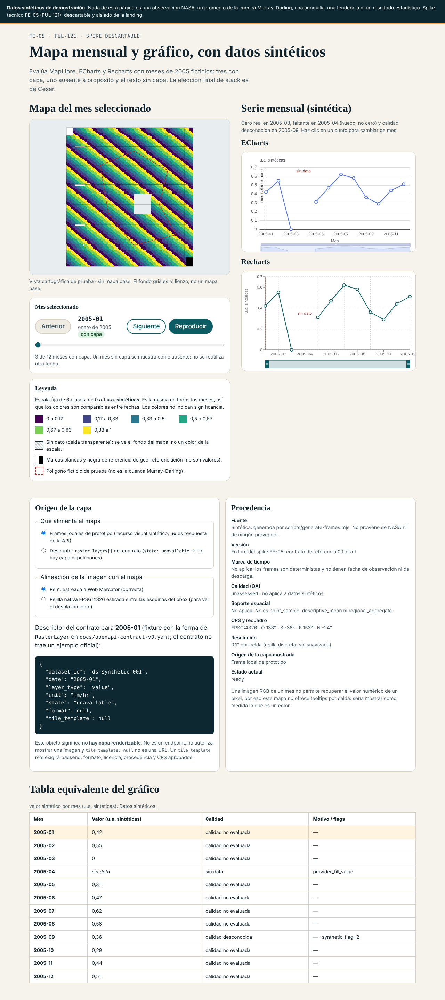
2. Mapa en febrero de 2005 (mes con capa): 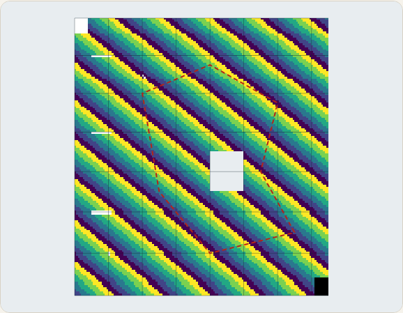
3. Mapa en abril de 2005 (mes ausente a propósito): 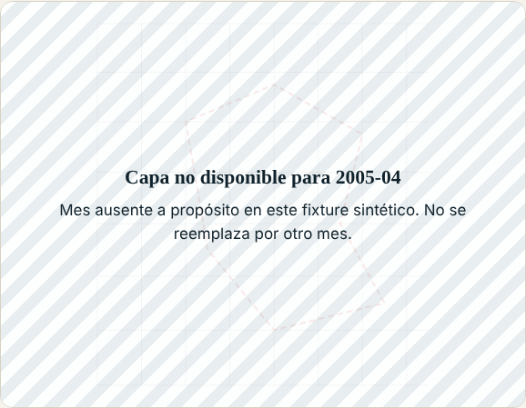
4. Modo contrato con `state: "unavailable"` (sin capa ni peticiones): 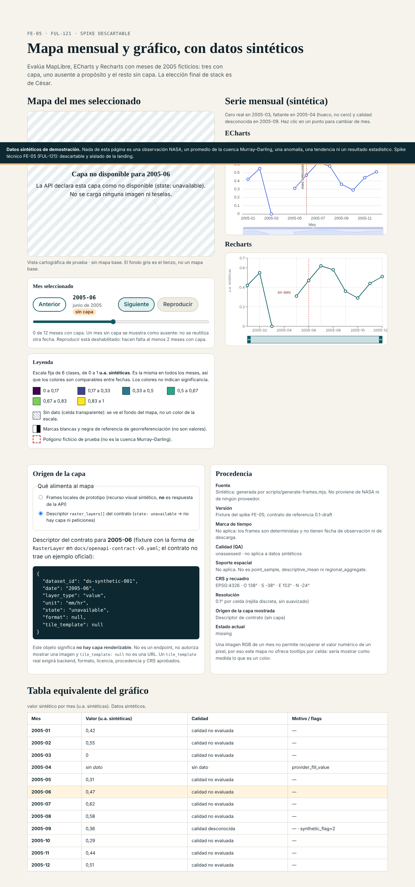
5. Rejilla nativa EPSG:4326 estirada entre las esquinas del bbox (las marcas blancas no coinciden con la cuadrícula): 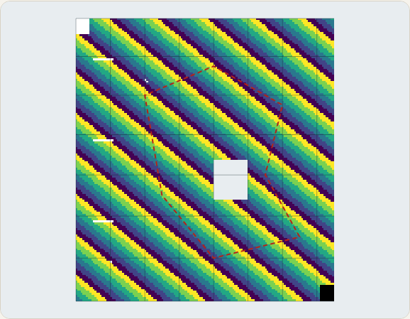
6. Imagen remuestreada a Web Mercator (las marcas coinciden dentro de una celda): 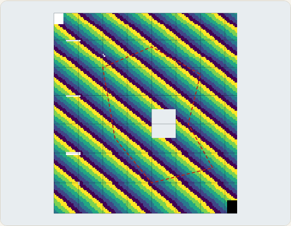
7. Móvil, parte superior con el mapa: 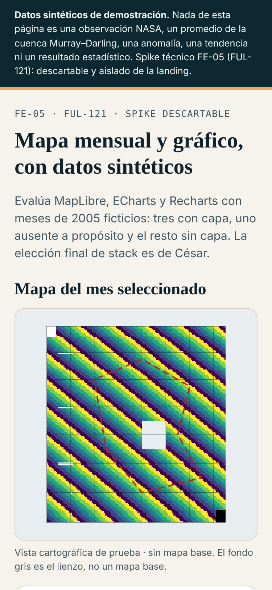
8. Móvil, línea de tiempo y leyenda: 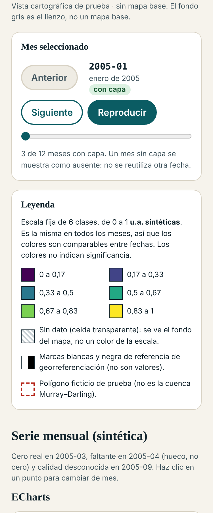
9. Móvil, ambos gráficos: 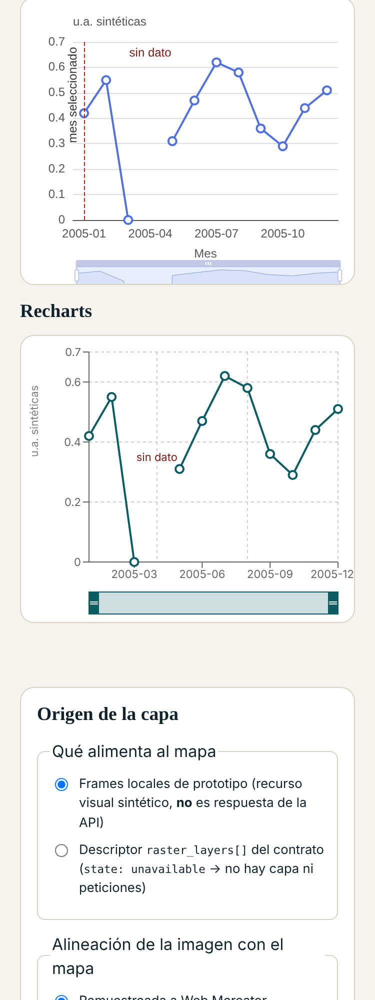
10. ECharts, tooltip sobre el mes sin dato: 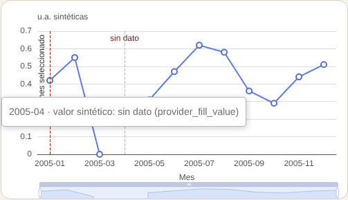
11. Recharts, navegación con flechas hasta el mes sin dato: 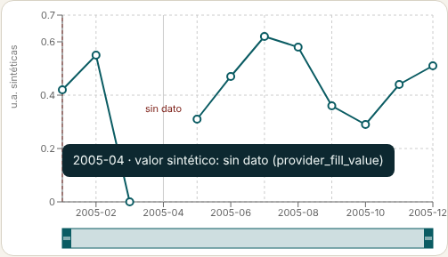
